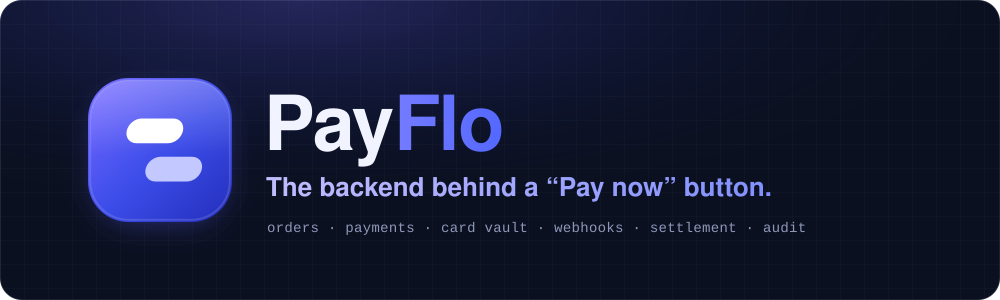
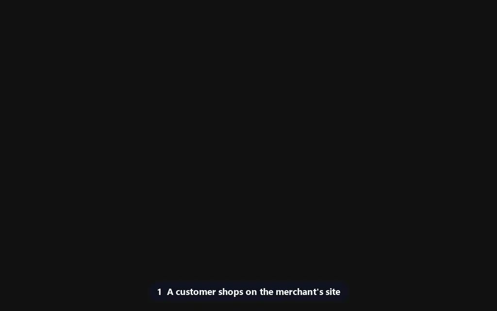
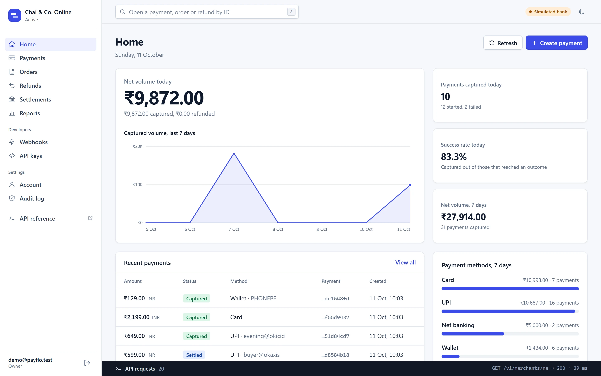
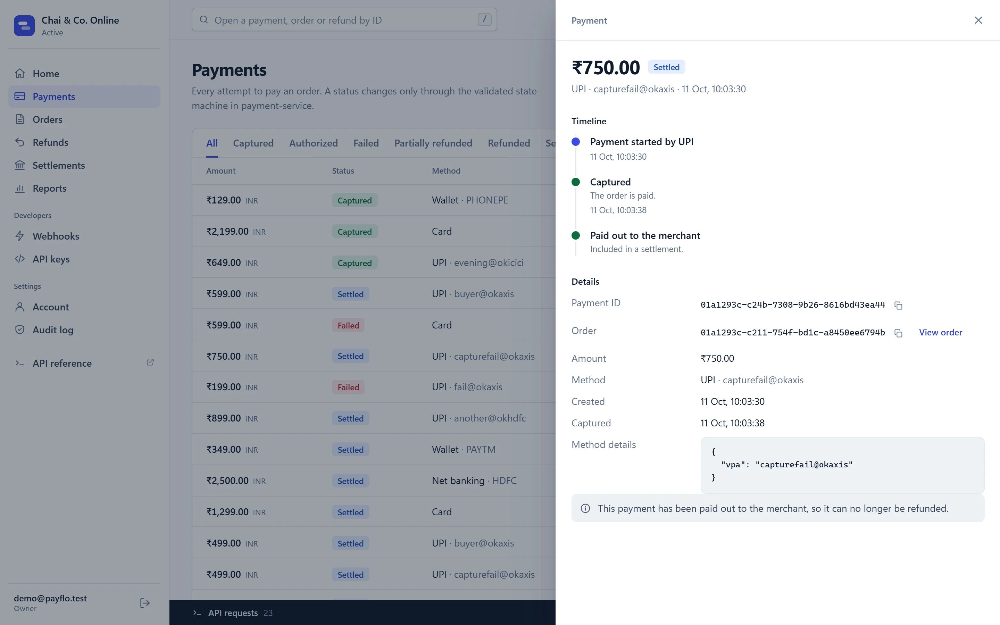
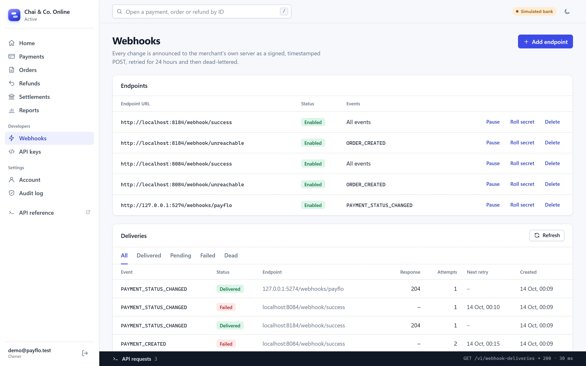
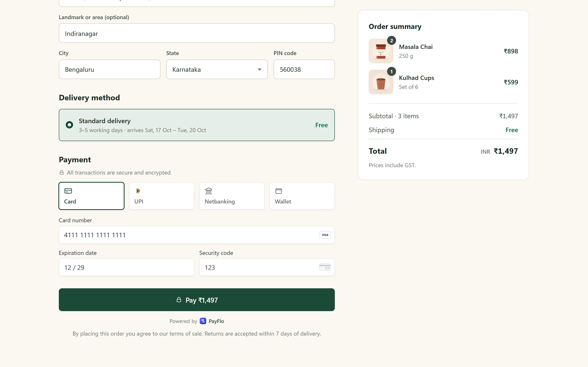
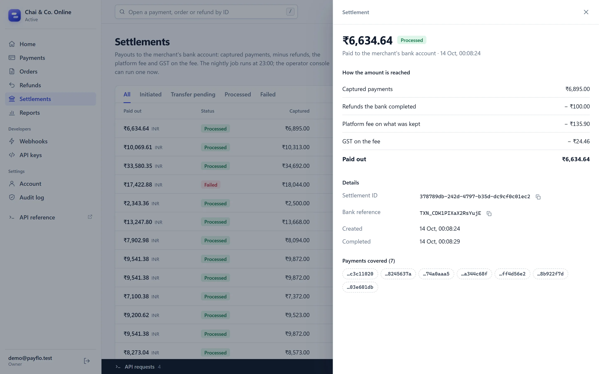
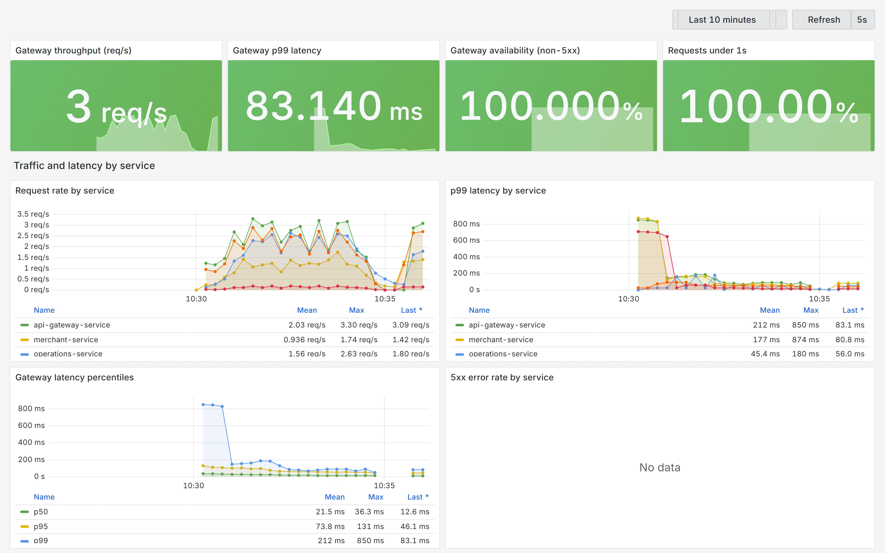
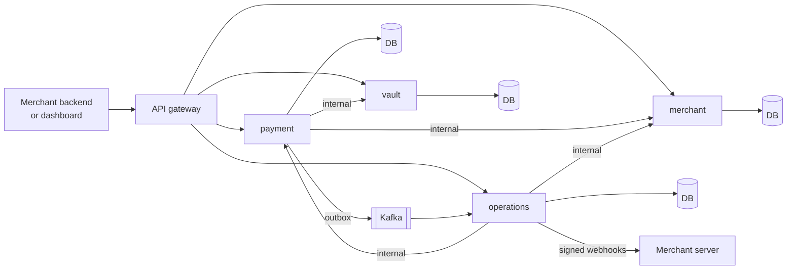
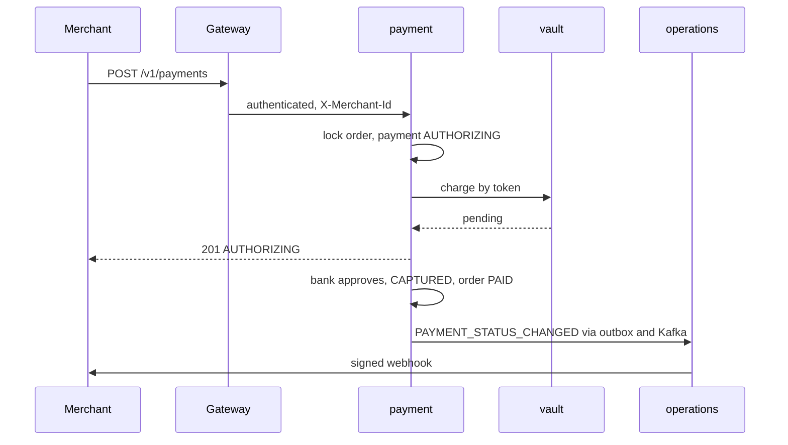

<p align="center">
  
</p>

<p align="center">
  <b>The backend behind a "Pay now" button.</b><br/>
  A payment gateway with a card vault, signed webhooks and payouts, built on Spring Boot microservices.
</p>

<p align="center">
  <a href="https://github.com/Divyanshu2805/payflo/actions/workflows/ci.yml"></a>
  
  
  
  
  
  
  
  
  
  
  
  
  <a href="LICENSE"></a>
</p>

<p align="center">
  <a href="#try-it"><b>Run it locally with one command</b></a>
</p>

---

A business signs up, gets API keys, creates orders and takes payments by card, UPI, net banking or wallet. Card numbers go into an isolated vault and come back as tokens. Every change reaches the business's own servers as a signed webhook, and each night the business is paid out, minus the platform fee and GST.

**PayFlo** is that system: seven services and four databases, with tests and measurements showing it stays correct when a component fails and fast when traffic rises. The bank side (acquirer, authorization callback, payouts) is simulated, so every flow runs on one machine.

<p align="center">
  
</p>

## Try it

With Docker, a JDK 25 and Python 3.10+:

```bash
git clone https://github.com/Divyanshu2805/payflo.git
cd payflo/microservices
python demo/demo.py
```

This starts PostgreSQL, Redis and Kafka, builds and starts the seven services, and seeds a demo merchant through the public API. The first run takes a few minutes; later runs about one.

| | |
|---|---|
| **Dashboard** | <http://localhost:5173>, login `demo@payflo.test` / `demo-password-1` |
| **Shop** | <http://localhost:5174>, the demo merchant's tea shop, paying through PayFlo |
| **Operator console** | The login page's operator tab, key `dev-admin-api-key-change-me` |
| **API explorer** | <http://localhost:5173/docs.html>: Swagger UI over [`openapi.yaml`](docs/api/openapi.yaml) |
| **Postman** | [`payflo.postman_collection.json`](docs/api/payflo.postman_collection.json) |

| Pay in the shop with | Result |
|---|---|
| Card `4111 1111 1111 1111`, any future expiry and CVC | Authorized, then captured within seconds |
| Card `4000 0000 0000 0002` | Declined; the order can be paid again |
| UPI `buyer@okaxis` | Authorized, then captured |
| UPI `fail@okaxis` | Rejected |
| UPI `capturefail@okaxis` | Authorized, capture refused, captured on retry |

Keep the dashboard's Payments page open beside the shop: the payment appears on its own and moves to `CAPTURED`, and the shop's confirmation ticks when the signed webhook arrives. If ports 8080–8084 are taken, add `--port-offset 100`. All test values are in the [API reference](docs/api/README.md#test-values).

## Screenshots

<p align="center">
  
</p>

| | |
|---|---|
|  |  |
| A payment and every status change | Webhook deliveries, retries and replay |
|  |  |
| The shop's checkout with PayFlo's payment form | A payout: gross − refunds − fee − GST = net |

<p align="center">
  
</p>

## Features

**Payments**
- Orders and payments by card, UPI, net banking and wallet, through pluggable adapters and processors.
- A validated state machine: 11 statuses, 12 events, every change logged, an illegal one refused.
- Payment initiation as a saga that never holds a database connection across a network call and compensates when the processor is unreachable.
- Asynchronous authorization and capture, retryable refused captures, timeouts, and full or partial refunds.

**Card vault**
- Card numbers live only in vault-service, each under its own AES-256-GCM key wrapped by a master key.
- Every other service sees a token. The CVV is never stored, and logs mask any card number.

**Events, webhooks and payouts**
- Events through a transactional outbox, so a change and its event commit together.
- Webhooks signed per attempt with HMAC-SHA256 over a timestamp and the body, up to seven attempts over 24 hours, then dead-lettered and replayable.
- Nightly settlement per merchant with fee and GST, as a recoverable saga linked to the exact payments it covers.

**Security and access**
- Authentication only at the gateway: JWTs for staff, API keys for backends, three roles, revocable sessions.
- Tenant isolation in every query; another merchant's resource is a `404`.
- Idempotent writes, rate limits, card-testing protection, login lockout and a 1 MB body cap.
- An append-only audit log written in the same transaction as each sensitive change, and an operator API behind its own key.

**Running it**
- A merchant dashboard and a sample shop, both clients of the public API.
- One trace per request in Zipkin, Prometheus metrics, and a Grafana dashboard for throughput, p99 and the webhook SLA.
- Kustomize manifests for kind, with a three-replica overlay and zero-downtime rollouts.

## Results

Measured on one laptop that also ran the load generator and the databases. Details in [docs/results.md](docs/results.md).

| Measure | Result |
|---|---|
| Throughput | **1,272 req/s** at p99 **171 ms**, 0 errors: 5× the first build |
| Webhooks within 30 s | **99.85%**, from 5.4% |
| Horizontal scaling | **3.0×** on 3 replicas |
| Crash and outage tests | **7 of 7**: no payment lost, duplicated or stuck |
| Duplicate requests | **0 of 33,600** took effect |

## How it works



| Service | Owns |
|---|---|
| API gateway | The only public entry point: authentication, rate limits, routing |
| merchant | Merchants, users, API keys, customers, webhook endpoints, the audit log |
| payment | Orders, payments, the state machine, refunds, analytics |
| vault | Card tokenization and the only decryption of card numbers |
| operations | Webhook delivery and nightly settlement |

Each business service owns its PostgreSQL database. Services discover each other through Eureka, read configuration from a config server, call each other over a private `/internal` API with circuit breakers, and exchange events through Kafka.

A card payment:



More in [docs/architecture.md](docs/architecture.md).

## Stack

| | |
|---|---|
| Services | Java 25, Spring Boot 4.1, Spring Cloud 2025.1 (Gateway, Eureka, Config, OpenFeign), virtual threads |
| Data | PostgreSQL per service with Flyway, Redis, Apache Kafka |
| Resilience | Resilience4j circuit breakers, retries and a bulkhead; ShedLock for every scheduled job |
| Security | bcrypt and AES-256-GCM (Spring Security Crypto), jjwt |
| Observability | Micrometer, Zipkin, Prometheus, Grafana |
| Delivery | Jib, Kustomize, kind, GitHub Actions |
| Testing | JUnit, Testcontainers, JMeter, crash and outage scripts |

## Running locally

```bash
cd microservices
./mvnw clean install -DskipTests     # build every module (mvnw.cmd on Windows)
./mvnw verify                        # every test; needs only Docker
python demo/demo.py                  # start and seed everything
python demo/demo.py stop             # stop it
```

Starting services by hand, configuration and troubleshooting are in [docs/development.md](docs/development.md). Kubernetes is in [docs/deployment.md](docs/deployment.md).

## Testing and CI

| Suite | |
|---|---|
| Unit | Money, security and state logic, with collaborators mocked |
| Integration | Each service as the real application on PostgreSQL, Redis and Kafka in containers |
| Crash and outage | Kill a service or stop a data store under load, then check the database |
| Load | JMeter through the gateway, graded on p99, errors, capture and webhook SLA |
| Idempotency | 33,600 duplicate requests under shared keys |

Every push runs the OpenAPI check against the controllers, every test, and a dependency and secret scan that fails on a fixable HIGH or CRITICAL vulnerability.

## Repository layout

```
microservices/
  api-gateway-service/   authentication, rate limits, routing        :8080
  merchant-service/      merchants, keys, webhooks, audit log         :8081
  payment-service/       orders, payments, refunds, analytics         :8082
  vault-service/         card tokenization                            :8083
  operations-service/    webhook delivery, settlement                 :8084
  discovery-service/     Eureka                                       :8761
  config-service/        Spring Cloud Config over config-repo/        :8888
  common-lib/            shared entities, errors, outbox, idempotency
  config-repo/           every service's configuration
  dashboard/, storefront/   the merchant dashboard and the sample shop
  demo/, load-test/, chaos/  the one-command demo, JMeter, crash tests
  k8s/, k8s-scaled/, observability/
docs/                    documentation
```

## Docs

| | |
|---|---|
| [Architecture](docs/architecture.md) | Services, flows, security, design decisions |
| [API reference](docs/api/README.md) | Endpoints, idempotency, limits, errors, webhooks, test values |
| [Data model](docs/data-model.md) | Tables per service, enums, migrations |
| [Development](docs/development.md) | Demo, setup, configuration, tests, troubleshooting |
| [Deployment](docs/deployment.md) | Kubernetes, scaling, observability |
| [Results](docs/results.md) | Every measurement and how to reproduce it |

## License

[MIT](LICENSE)
