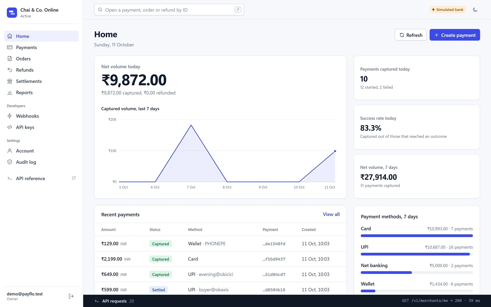
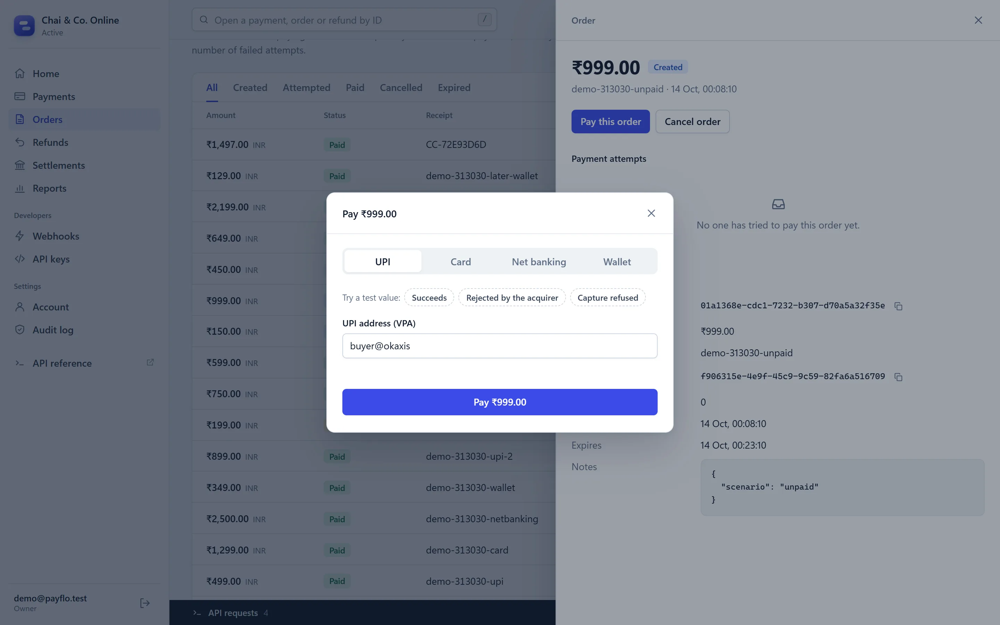
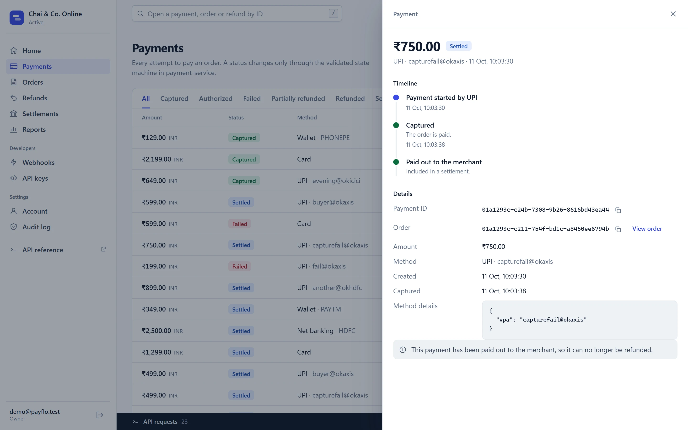
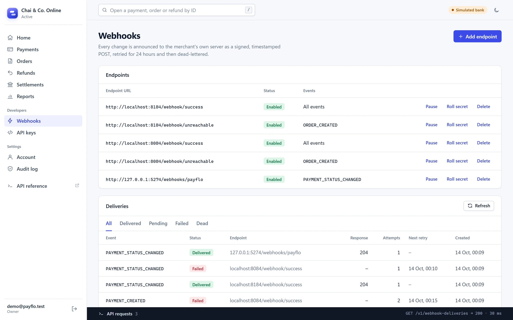
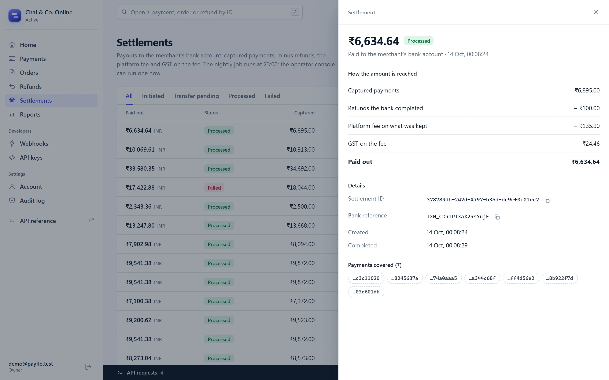
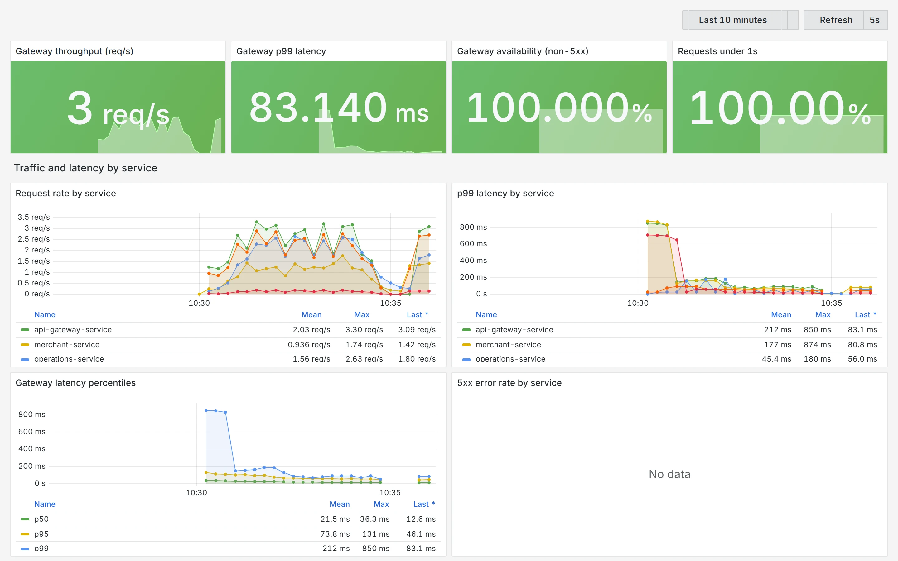

<p align="center">
  
</p>

<h1 align="center">PayFlo</h1>

<p align="center">
  <b>The backend behind a "Pay now" button.</b><br/>
  Orders, payments, a card vault, signed webhooks and nightly payouts, as Spring Boot microservices.
</p>

<p align="center">
  <a href="https://github.com/Divyanshu2805/payflo/actions/workflows/ci.yml"></a>
  
  
  
  
  
  
  
  
  
  
  
  
  
  
  
  
  
  <a href="LICENSE"></a>
</p>

<p align="center">
  <a href="#try-it"><b>Run it locally with one command</b></a>
</p>

---

A business signs up, gets API keys, creates orders and takes payments by card, UPI, net banking or wallet. Card numbers go into an isolated vault and come back as tokens. Every change is announced to the business's own systems as a signed webhook, and each night the business is paid out, minus the platform fee and GST. **PayFlo** is that system: seven services, four databases, and the tests and measurements that show it stays correct when something fails and fast when traffic rises.

The bank side (acquirer, authorization callback, payouts) is simulated, so every flow runs on one machine with no external accounts.

## Try it

With Docker running, a JDK 25 and Python 3.10+:

```bash
git clone https://github.com/Divyanshu2805/payflo.git
cd payflo/microservices
python demo/demo.py
```

One command starts PostgreSQL, Redis and Kafka, builds the services, starts all seven, and seeds a demo merchant through the public API: KYC, an API key, webhooks, payments by every method, the failure cases, a refund and a settlement. The first run takes a few minutes for the build; after that about one.

| | |
|---|---|
| **Dashboard** | <http://localhost:5173> |
| **Shop** | <http://localhost:5174>: the demo merchant's tea shop. Check out as a customer and pay by card `4111 1111 1111 1111` (any future expiry, any CVC) or UPI `buyer@okaxis`, with the dashboard open beside it to watch the payment arrive |
| **Demo login** | `demo@payflo.test` / `demo-password-1` (owner) |
| **Operator console** | The login page's operator tab, with the development admin key from the [admin API](docs/api/admin.md) page |
| **API reference** | <http://localhost:5173/docs.html>: Swagger UI over [`openapi.yaml`](docs/api/openapi.yaml), with "Try it out" calling the real API |
| **Postman** | Import [`payflo.postman_collection.json`](docs/api/payflo.postman_collection.json): the same API as a walkthrough |

### See it working: a 5-minute walkthrough

Everything below uses test data only. The bank is simulated, so no real card, account or money is involved.

1. **Wait for the demo to finish.** `python demo/demo.py` prints the dashboard and shop addresses when the seed is done. `python demo/demo.py status` shows what is up.
2. **Sign in to the dashboard** at <http://localhost:5173> with `demo@payflo.test` / `demo-password-1`. The home page already shows the seeded payments, a seven-day trend and the payment methods. The **Payments**, **Refunds**, **Webhooks** and **Settlements** pages show the rest of what the seed created.
3. **Pay in the shop.** Open <http://localhost:5174>, add something to the cart and check out with any name and address. Keep the dashboard's **Payments** page open beside it.

   | Pay with | Test value | Result |
   |---|---|---|
   | Card | `4111 1111 1111 1111`, any future expiry, any CVC | Authorized, then captured within seconds |
   | Card | `4000 0000 0000 0002` | Declined: the checkout says so and the same order can be paid again |
   | UPI | `buyer@okaxis` | Authorized, then captured |
   | UPI | `fail@okaxis` | Rejected |
   | UPI | `capturefail@okaxis` | Authorized, then the capture is refused; the payment waits as `AUTHORIZED` |

   The payment appears in the dashboard on its own and moves `AUTHORIZING` to `CAPTURED`. The confirmation page ticks "Payment confirmed" when PayFlo's signed webhook reaches the shop.
4. **Check the webhook.** On the dashboard's **Webhooks** page the delivery shows its status, attempts and response code. It carries `X-PayFlo-Timestamp` and `X-PayFlo-Signature`.
5. **Look at a refund.** The dashboard's **Refunds** page lists the refund the seed made, and a payment's detail page shows it on its timeline. The dashboard only reads: to refund a payment you just made, use `POST /v1/payments/{paymentId}/refunds` from step 7 (leave `amountUnits` out to refund the whole payment). It resolves in a few seconds.
6. **Run a settlement.** Settlement normally runs at 23:00. To see it now, open the login page's **operator** tab, enter the development admin key `dev-admin-api-key-change-me` and run a settlement for the demo merchant. The **Settlements** page then shows gross, refunds, fee, GST and net.
7. **Call the API yourself.** Open <http://localhost:5173/docs.html> and use "Try it out", or import the [Postman collection](docs/api/payflo.postman_collection.json). The demo saves an API key in `microservices/demo/.run/api-key.json`.

All the test values are listed in the [mock acquirer](docs/api/mock-acquirer.md). These logins and the admin key are development defaults, so never reuse them in a shared environment.

If ports 8080 to 8084 are taken, `python demo/demo.py --port-offset 100` moves everything; `python demo/demo.py stop` stops the services. See [the demo and the dashboard](docs/local-development/demo-and-dashboard.md).

## Screenshots

<p align="center">
  
</p>

| | |
|---|---|
|  |  |
| Paying an order, with the test values one click away | A payment and every status change it went through |
|  |  |
| Webhook deliveries: attempts, responses and replay | A payout: gross − refunds − fee − GST = net |

**The demo merchant's shop**, the customer's side of the same payments. Its server holds the API key and calls PayFlo; the browser never sees it.

| | |
|---|---|
|  |  |
| A merchant's storefront, built on the public API | The cart: prices come from the shop's server, never the browser |
|  |  |
| Checkout, with PayFlo's embedded payment form | "Payment confirmed" ticks when PayFlo's signed webhook arrives |

<p align="center">
  
</p>

The Grafana dashboard while the demo seeds payments. All screenshots are from the one-command demo on a local stack, against the simulated bank; the load-test figures are under [Quality](#quality).

## Features

**Taking payments**
- **Orders and payments** by card, UPI, net banking and wallet, through a strategy layer of adapters and processors
- **A validated state machine**: 11 statuses and 12 events in one transition table, every change logged, an illegal one refused
- **A saga, not a long transaction**: initiation never holds a database connection across a network call, and compensates when the processor is unreachable
- **Authorization, capture and timeouts**: a refused capture can be retried, an unanswered payment fails after 15 minutes, an uncaptured authorization lapses after 60
- **Refunds**, full or partial, netted out of the payout

**Keeping card data in one place**
- **A card vault** in its own service and database, with a data key per card (AES-256-GCM) wrapped by a master key only the vault holds
- Every other service sees a token; the CVV is never stored; a log filter masks any card number that reaches a log line

**Telling the merchant, and paying them**
- **Events through a transactional outbox**: a change and its event commit together, so a crash can't lose one
- **Webhooks** signed per attempt with HMAC-SHA256 over a timestamp and the body, retried seven times over 24 hours, then dead-lettered and replayable
- **Nightly settlement** per merchant with a fee and GST breakdown, as a recoverable saga linked to the exact payments it covers

**Access, safety and accountability**
- **Two credentials, one check**: a JWT for staff and API keys for backends, both verified once at the gateway; three roles, with `TEAM` read-only
- **Idempotent writes**: any write can be retried with `X-Idempotency-Key`, and the same key with a different request is refused
- **Abuse protection**: rate limits per key, merchant and address, card-testing rules on tokenizing and card payments, login lockout, and a signup that doesn't reveal which emails exist
- **An append-only audit log** written in the same transaction as each sensitive change, and an operator API behind a key of its own

**Running and watching it**
- **Analytics**: a live dashboard and reports by day, week or month
- **Observability**: one trace per request across every service in Zipkin, Prometheus metrics, and a Grafana dashboard for throughput, p99, availability and the webhook SLA
- **A web dashboard** over the public API, with live payments, and **a sample shop** whose checkout embeds PayFlo's payment form, a hand-written OpenAPI spec checked against the controllers, and a Postman collection

Everything, with its rules and limits: [features](docs/features.md).

## How a payment flows

1. **Sign up and get credentials.** merchant-service creates the merchant and issues a JWT and API keys.
2. **Create an order.** payment-service records what is being paid for, resolving the customer from merchant-service first.
3. **Pay.** The payment moves to `AUTHORIZING`; a card is charged by vault-service using only its token.
4. **The bank answers.** A simulated bank authorizes and captures the payment within seconds; the order becomes `PAID`.
5. **The merchant is told.** The outbox publishes the change to Kafka, and operations-service delivers a signed webhook.
6. **The merchant is paid.** At 23:00 operations-service settles each merchant's captured payments to their bank account.

## Architecture

A Spring Cloud Gateway authenticates every request and routes it to one of four business services (**merchant**, **payment**, **vault** and **operations**), each with its own PostgreSQL database. Services find each other through Eureka, pull their configuration from a config server, call each other over a private `/internal` API with circuit breakers and retries, and exchange events through Kafka. Card numbers never leave vault-service, and authentication happens in exactly one place.

| Area | Choice |
|---|---|
| Services | Java 25 and Spring Boot 4.1; Spring Cloud 2025.1 (Gateway Server Web MVC, Eureka, Config, OpenFeign); virtual threads |
| Data | PostgreSQL, one database per service: 18 tables, 12 Flyway migrations, no foreign keys across services |
| Messaging | Apache Kafka, four topics and eleven event types, published through a transactional outbox |
| State and locks | Redis: API-key cache, rate limits, idempotency keys, sessions, the webhook retry queue, ShedLock for every scheduled job |
| Resilience | Resilience4j circuit breakers and retries on every Feign client, a bulkhead around card charging |
| Security | Authentication at the gateway only; bcrypt and AES-256-GCM through Spring Security Crypto; jjwt |
| Delivery | Jib images, Kustomize manifests for a kind cluster, GitHub Actions |
| Quality | JUnit and Testcontainers, JMeter, crash and outage tests, a dependency and secret scan |

The decisions behind the shape, each with the alternatives it was chosen over:

| Decision | Why |
|---|---|
| [Monolith first, then split](docs/architecture/decisions/0001-monolith-first-then-split.md) | Find the service boundaries while moving them is cheap |
| [A database per service](docs/architecture/decisions/0002-database-per-service.md) | A service changes its schema, or scales, without touching the others |
| [Authenticate once at the gateway](docs/architecture/decisions/0003-authenticate-once-at-the-gateway.md) | One place holds the credential logic and the rate limits |
| [Card data isolated in vault-service](docs/architecture/decisions/0004-isolate-card-data-in-vault-service.md) | One small service handles card numbers instead of all of them |
| [Transactional outbox for events](docs/architecture/decisions/0005-transactional-outbox-for-events.md) | A change and its event commit together or not at all |
| [Payment initiation as a saga](docs/architecture/decisions/0006-payment-initiation-as-a-saga.md) | No database connection held across a remote call |
| [A validated payment state machine](docs/architecture/decisions/0007-validated-payment-state-machine.md) | An illegal status change is impossible, and every change is logged |
| [Configuration in the repository](docs/architecture/decisions/0008-configuration-in-the-repository.md) | Every setting is versioned and reviewed like code |

More in the [architecture overview](docs/architecture/README.md), the [request flows](docs/architecture/README.md) and the [tech stack](docs/tech-stack.md).

## Security

The rules are written down in the [security guardrails](docs/practices/security-guardrails.md) and the [security model](docs/architecture/security-model.md). In short:

- **Tenant isolation in code:** the merchant comes only from the credential the gateway verified, every query is scoped by it, and another merchant's order, payment or key is a `404`, never a `403`.
- **One place authenticates:** the gateway strips every identity header a client sends and writes its own. No business service is reachable from outside, and `/internal/**` is never routed and needs a service token.
- **Card data:** envelope-encrypted in one service, charged by token, never returned, never logged; the CVV is never stored.
- **Secrets at rest:** passwords and API-key secrets are bcrypt hashes, webhook secrets and payout account numbers are encrypted, and a secret is returned only in the response that creates it.
- **Webhooks:** signed with a timestamp per attempt, so a replayed request fails; target URLs are checked against private and metadata addresses when saved and again at delivery.
- **Abuse:** rate limits that fail open, card-testing limits where the card is handled, login lockout, uniform answers for unknown emails, and a 1 MB body cap applied before authentication.
- **Accountability:** an append-only audit log with no secrets in it, and an operator API that a merchant credential can never open.
- **Supply chain:** CI fails on a fixable HIGH or CRITICAL dependency vulnerability and on a committed secret.

Found a problem? See [SECURITY.md](SECURITY.md).

## Quality

Everything below was measured on one laptop that also ran the load generator and the databases. Each figure, and how to re-measure it, is on the [metrics page](docs/metrics.md).

| What | Measured |
|---|---|
| Throughput | **1,272 requests a second**, with payments captured alongside; the first run managed 250 |
| p99 latency | **171 ms** for the slowest request type |
| Errors under load | **0 failed requests** in 227,613 |
| Webhook delivery | **99.85%** of 91,644 events within 30 seconds of the change |
| Horizontal scaling | **338 → 758 → 999 requests a second** on 1, 2 and 3 Kubernetes replicas of the gateway and payment-service (3.0×) |
| Rolling restart under load | 19 of 226,834 requests failed (99.992% succeeded); no payment duplicated or stuck |
| Crashes and outages | **7 scenarios, all passing**: kill a service or stop PostgreSQL, Redis or Kafka under load; nothing lost, duplicated or stuck |
| Retries | 33,600 duplicate requests under reused idempotency keys; none took effect |
| Tests | **633** unit and integration tests; the integration tests run each service on real PostgreSQL, Redis and Kafka in containers |

The five-fold gain since the first run came from 19 fixes, every one of them invisible one request at a time: the gateway's 5-connection proxy pool, Open-Session-In-View holding connections across remote calls, an outbox row updated right after its insert, a webhook consumer committing once per event. The run-by-run story is in the [load-test results](docs/load-testing/results.md).

## Quick start

Requires a JDK 25, Docker and Python 3.10+. The [demo](#try-it) is the fastest way in; to build and test instead:

```bash
cd microservices
./mvnw clean install -DskipTests      # build every module (mvnw.cmd on Windows)
./mvnw verify                         # every unit and integration test; needs only Docker
```

To start each service by hand, see [first-time setup](docs/local-development/setup.md).

### Commands

```bash
python demo/demo.py                             # start everything, seed a merchant, serve the dashboard and the shop
python demo/demo.py seed | status | stop        # more data, what is up, stop the services
./mvnw verify                                   # every test, as CI runs it
python ../docs/api/check_openapi.py             # the OpenAPI spec must match the controllers
python chaos/crash_and_outage_test.py           # kill and outage tests against the running stack
kubectl apply -k k8s                            # deploy to a kind cluster (k8s-scaled for three replicas)
```

The full list is in [commands](docs/local-development/commands.md).

## Repository layout

```
microservices/
  common-lib/             shared entities, enums, errors, MerchantContext, idempotency, the outbox, DTOs
  discovery-service/      Eureka (:8761)
  config-service/         Spring Cloud Config over config-repo/ (:8888)
  config-repo/            every service's configuration, including the k8s profile
  api-gateway-service/    authentication, rate limiting, routing (:8080)
  merchant-service/       merchants, users, API keys, customers, webhook configs, the audit log (:8081)
  payment-service/        orders, payments, state machine, saga, refunds, analytics, bank simulator (:8082)
  vault-service/          card tokenization and charging (:8083)
  operations-service/     webhook delivery and nightly settlement (:8084)
  test-support/           the containers the integration tests share
  demo/                   the one-command demo
  dashboard/              the web dashboard and its server (:5173)
  storefront/             a sample merchant's shop and checkout, and its backend (:5174)
  k8s/, k8s-scaled/       Kubernetes manifests (Kustomize), and an overlay with three replicas
  observability/          Zipkin, Prometheus, Grafana
  load-test/, chaos/      the JMeter plan and its scripts; the crash and outage tests
services.docker-compose.yaml   local PostgreSQL, Redis, Kafka, Control Center
docs/                     documentation
.github/workflows/        CI: the OpenAPI check, every test, dependency and secret scans
```

## Deployment

The whole system runs on a local kind cluster: one namespace, the six applications built as Jib images, PostgreSQL, Redis and Kafka as StatefulSets, and only the gateway exposed. Secrets come from a gitignored file through a Kustomize `secretGenerator`, and each pod gets only the secrets it needs. An overlay runs three replicas of the gateway and payment-service with rolling updates and disruption budgets.

See [deployment](docs/deployment/README.md) and [scaling](docs/deployment/scaling.md).

## Documentation

Everything lives in [`docs/`](docs/README.md):

| Section | Covers |
|---|---|
| [Features](docs/features.md) | Everything the system does, with its rules and limits |
| [Project metrics](docs/metrics.md) | Every measured figure, and how to re-measure it |
| [The demo, the dashboard and the shop](docs/local-development/demo-and-dashboard.md) | One command, and what to look at |
| [Local development](docs/local-development/README.md) | Prerequisites, setup, configuration, commands, troubleshooting |
| [Architecture](docs/architecture/README.md) | Services, module map, request flows, security model, decision records |
| [Data model](docs/schema/README.md) | Databases, tables, enums, state machines, conventions |
| [API reference](docs/api/README.md) | Every endpoint, the OpenAPI spec, the mock acquirer, idempotency, errors |
| [Engineering practices](docs/practices/README.md) | Conventions, guardrails, testing, definition of done, known pitfalls |
| [Deployment](docs/deployment/README.md) | Images, manifests, running and scaling on Kubernetes |
| [Observability](docs/observability/README.md) | Tracing, metrics and the Grafana dashboard |
| [Load testing](docs/load-testing/README.md) | Running the load test, the results and the query review |
| [Crash and outage tests](docs/reliability/crash-and-outage-tests.md) | What happens to a payment when something dies |
| [Security](SECURITY.md) | Reporting a vulnerability |

## License

Released under the [MIT License](LICENSE).
