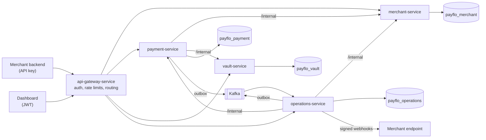
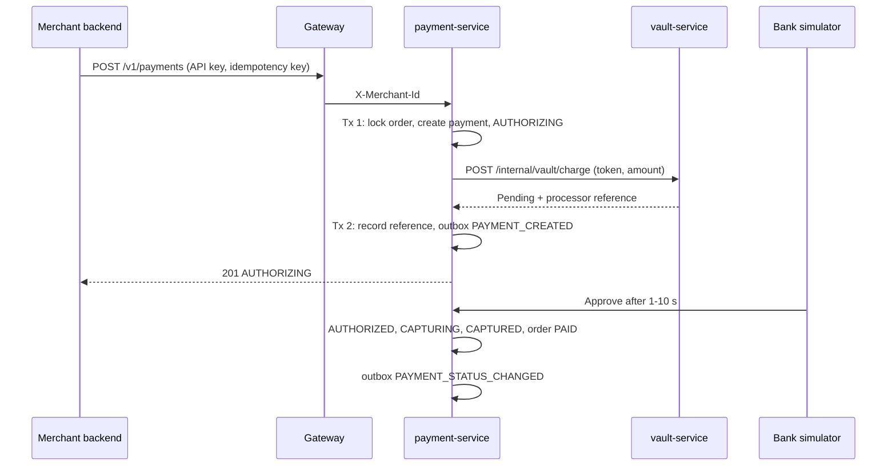
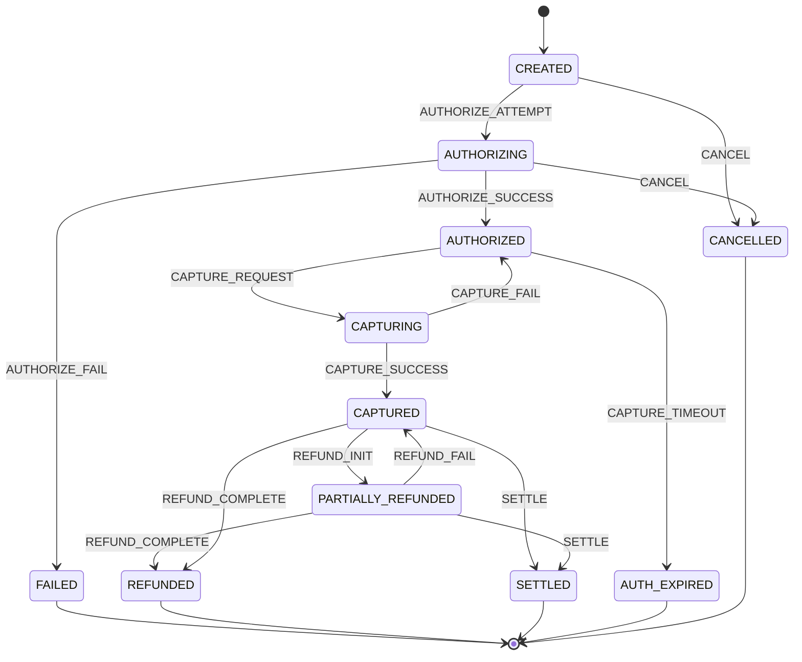
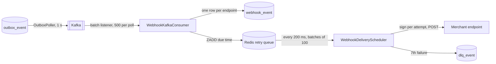
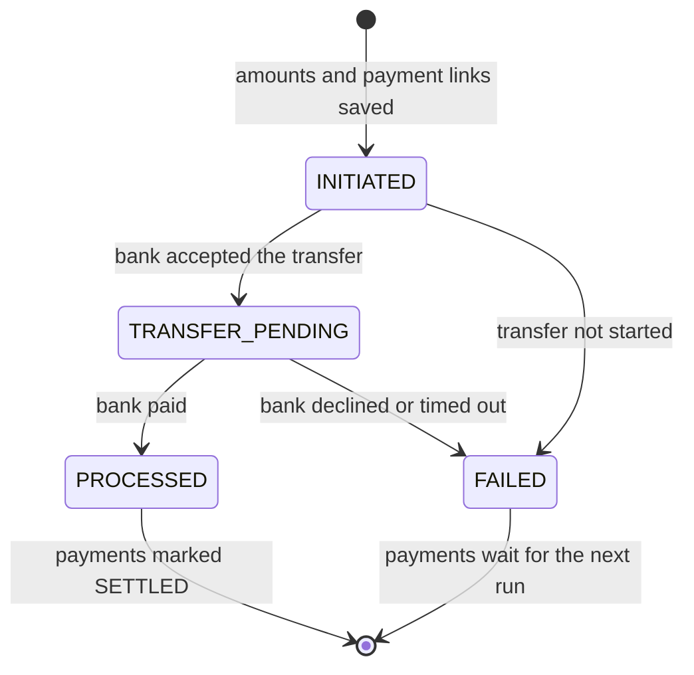
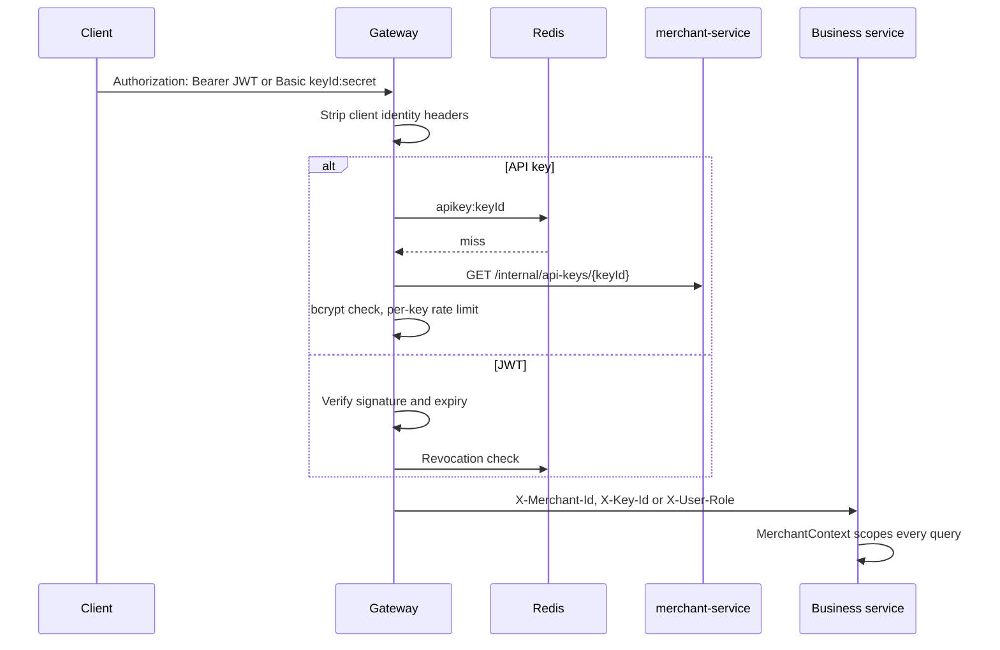

# Architecture

PayFlo is seven Spring Boot services under `microservices/`: an API gateway, four business services that each own a PostgreSQL database, Eureka for discovery and a config server. They talk over a private `/internal` API and through Kafka events.

- [System](#system)
- [Services](#services)
- [How services talk](#how-services-talk)
- [Payment flow](#payment-flow)
- [Webhook delivery](#webhook-delivery)
- [Settlement](#settlement)
- [Security](#security)
- [Cross-cutting](#cross-cutting)
- [Design decisions](#design-decisions)
- [Where to change things](#where-to-change-things)

## System

| Infrastructure | Used for |
|---|---|
| PostgreSQL | One database per service, schema owned by Flyway |
| Redis | API-key cache, rate and velocity counters, idempotency keys, sessions, the webhook retry queue, ShedLock |
| Kafka | Domain events on `orders.events`, `payments.events`, `refunds.events`, `settlements.events` |
| Eureka | Service discovery by name locally; Kubernetes Services replace it in-cluster |
| Config server | Every setting, served from `microservices/config-repo/` |

The bank side is simulated: the acquirer (`PaymentProcessor` per method), the bank's authorization callback (`BankCallbackSimulator`) and the payout bank (`BankSettlementCallbackSimulator`). Each answers after a delay and fails on [documented test values](api/README.md#test-values).

## Services

| Service | Port | Owns | Public paths |
|---|---|---|---|
| `api-gateway-service` | 8080 | Authentication, rate limits, routing. Spring Cloud Gateway Server Web MVC | — |
| `merchant-service` | 8081 | Merchants, users, API keys, customers, webhook configs, the audit log. Issues JWTs | `/v1/auth`, `/v1/merchants`, `/v1/admin/merchants`, `/v1/admin/audit-log` |
| `payment-service` | 8082 | Orders, payments, the state machine, refunds, analytics, the bank simulator | `/v1/orders`, `/v1/payments`, `/v1/refunds`, `/v1/analytics` |
| `vault-service` | 8083 | Card tokenization and the only decryption of card numbers | `/v1/vault` |
| `operations-service` | 8084 | Webhook delivery and nightly settlement | `/v1/settlements`, `/v1/webhook-deliveries`, `/v1/admin/settlements` |
| `discovery-service` | 8761 | Eureka | — |
| `config-service` | 8888 | Spring Cloud Config, native backend over `config-repo/` | — |

`common-lib` is the shared library: `BaseEntity` and `Money`, the enums, the exceptions and `GlobalExceptionHandler`, `MerchantContext`, the rate limiter, the idempotency filter, the transactional outbox, card masking for logs, and the DTOs exchanged over Feign. Its beans are registered through `Shared*AutoConfiguration`, not component scanning.

Inside each business service the layering is the same:

| Package | Holds | Rule |
|---|---|---|
| `controller` | `/v1/**` endpoints and `Internal*Controller`s | Reads the merchant only from `MerchantContext` |
| `service`, `service.impl` | Business logic | No remote call inside `@Transactional` |
| `repository` | Spring Data JPA; `…ForUpdate` finders lock the row | Queries only |
| `entity`, `mapper`, `dto` | JPA mappings, MapStruct mappers, request and response records | No relation to another service's entity |
| `client` | Feign clients, each with a circuit breaker and retry | Never called inside a transaction |

## How services talk

**The gateway** routes by path to the owning service (`lb://<service>` locally, `http://<service>` on Kubernetes). `/internal/**` has no route and there is no catch-all, so an unknown path is a `404` from the gateway.

**The internal API** carries the calls that need an answer now:

| Endpoint | Owner | Caller | Purpose |
|---|---|---|---|
| `GET /internal/api-keys/{keyId}` | merchant | gateway | Load an API key on a cache miss |
| `GET /internal/merchants/{id}/status` | merchant | gateway | Refuse a suspended merchant (cached 60 s) |
| `POST /internal/customers/find-or-create` | merchant | payment | Resolve an order's customer |
| `GET /internal/merchants/{id}/webhook-targets` | merchant | operations | Subscribed endpoints and their signing secrets |
| `GET /internal/merchants/{id}/webhook-targets/{configId}` | merchant | operations | One endpoint's current secret, per delivery attempt |
| `GET /internal/merchants/active-ids` | merchant | operations | Who to settle |
| `GET /internal/merchants/{id}/settlement-bank-details` | merchant | operations | Where to pay out |
| `POST /internal/audit` | merchant | operations | Record the operator's settlement run |
| `POST /internal/vault/charge` | vault | payment | Charge a card by token |
| `GET /internal/payments/unsettled-captured` | payment | operations | Captured payments not yet paid out |
| `POST /internal/payments/mark-settled` | payment | operations | Mark paid-out payments `SETTLED` |

Every call carries `X-Internal-Token`, has explicit timeouts (2 s connect, 5 s read, 8 s for the vault) and a Resilience4j circuit breaker and retry that count only remote failures. An open breaker answers `503 DEPENDENCY_UNAVAILABLE` with `Retry-After: 10`. The card charge is never retried automatically, and runs behind a thread-pool bulkhead in vault-service.

**Events** go through a transactional outbox: the service writes an `outbox_event` row in the same transaction as the change, and `OutboxPoller` publishes pending rows to Kafka every second, 500 at a time, marking them `PUBLISHED` once acknowledged. An event is published if and only if its change committed, and delivered at least once.

| Topic | Producer | Events |
|---|---|---|
| `orders.events` | payment | `ORDER_CREATED`, `ORDER_CANCELLED`, `ORDER_EXPIRED` |
| `payments.events` | payment | `PAYMENT_CREATED`, `PAYMENT_STATUS_CHANGED`, `PAYMENT_AUTHORIZATION_COMPENSATED` |
| `refunds.events` | payment | `REFUND_CREATED`, `REFUND_PROCESSED`, `REFUND_FAILED` |
| `settlements.events` | operations | `SETTLEMENT_PROCESSED`, `SETTLEMENT_FAILED` |

operations-service consumes all four topics to deliver webhooks.

## Payment flow

Payment initiation is a saga: two short transactions around the call to the processor, so no database connection is held across a network call.

| Step | What happens |
|---|---|
| Create order | The customer is resolved from merchant-service first, then the order is saved `CREATED` with an `ORDER_CREATED` outbox row. Expires after 15 minutes by default |
| Transaction 1 | Locks the order (`SELECT … FOR UPDATE`), requires it payable and unexpired with no live payment, creates the payment and fires `AUTHORIZE_ATTEMPT` |
| Processor call | Card: vault-service decrypts and charges by token. UPI, net banking, wallet: the local processor. No transaction is open |
| Transaction 2 | Records the processor reference (`AUTHORIZING`) or the decline (`FAILED`) and writes `PAYMENT_CREATED` |
| Compensation | If nothing was sent (vault down, breaker open), the payment fails with `PAYMENT_GATEWAY_ROUTER_UNREACHABLE` and `PAYMENT_AUTHORIZATION_COMPENSATED` is published. A read timeout after sending leaves it `AUTHORIZING` for the bank's answer |
| Bank answer | `BankCallbackSimulator` resolves due payments 50 per transaction, 4 batches at once, and captures each approval at once |
| Refused capture | The payment returns to `AUTHORIZED` with `CAPTURE_DECLINED`; `POST /v1/payments/{id}/capture` retries it |
| Timeouts | Unanswered for 15 minutes: `FAILED`. Authorized and uncaptured for 60 minutes: `AUTH_EXPIRED`. Unpaid orders past expiry: `EXPIRED` |
| Refunds | A refund is saved `PENDING` under the payment's lock; `RefundResolver` answers a few seconds later with `PROCESSED` or `FAILED` |

### Payment state machine

Every status change goes through `PaymentTransitionService`, which checks it against the table in `PaymentStateMachine` and writes a `payment_transition_log` row. An undefined move is `409 INVALID_STATE_TRANSITION`.

`AUTHORIZING` and `CAPTURING` are explicit in-flight states, so a request already sent to the acquirer is never confused with one that wasn't.

## Webhook delivery

| Stage | Behaviour |
|---|---|
| Fan-out | The consumer saves one `webhook_event` per subscribed endpoint, all records of a poll in one transaction, with the body serialized once |
| Claim | A batch is locked and leased for two minutes in one short transaction, so an event is never sent twice at once |
| Send | Concurrent on virtual threads, at most 32 calls in flight. The URL is re-validated, the current secret is fetched, and the body is signed with a fresh timestamp |
| Record | Every `2xx` of a batch becomes `DELIVERED` in one `UPDATE`. A failure is retried after 1 min, 5 min, 30 min, 2 h, 8 h and 24 h; the seventh failure moves it to `DEAD` and the DLQ |
| Reconcile | Every 10 s, overdue `PENDING` and `FAILED` rows with no queue entry are queued again, so the database stays the source of truth |
| Replay | `POST /v1/webhook-deliveries/{id}/replay` sends the same body and event id, signed afresh |

A dependency outage (database, Redis, merchant-service) makes the consumer `nack` and Kafka redeliver; a malformed record goes to the DLQ on its own and the rest of the batch continues.

## Settlement

Each night at 23:00 `SettlementEngine` settles every `ACTIVE` merchant with a payout account, four at a time. Settlement is a sequence of short transactions with the remote calls between them.

| Step | What happens |
|---|---|
| Read | Captured, unsettled payments from payment-service, oldest first, after the T+N hold, skipping any already in an open payout or with a refund pending |
| Compute | Per currency: `gross`, completed `refunds`, `fee` = 2% of `gross − refunds`, `GST` = 18% of the fee, `net` = `gross − refunds − fee − GST` |
| Record | The `settlement` and a `settlement_payment` row per payment, then the transfer to the bank with the settlement id as reference |
| Confirm | The payout callback marks it `PROCESSED`, then payment-service marks the covered payments `SETTLED` through the state machine |

`SettlementRecoveryJob` runs every minute and finishes any settlement a crash interrupted:

| Stuck in | Recovery |
|---|---|
| `INITIATED` | The transfer is started again; the bank identifies it by settlement id, so it is paid once |
| `PROCESSED`, payments not yet marked | The payments are marked `SETTLED`; until then they are held back from new payouts |
| `TRANSFER_PENDING` past 120 minutes | Failed with `TRANSFER_TIMEOUT`; the payments go in the next run |

The operator can run the same settlement on demand through `POST /v1/admin/settlements/run`, under the same lock as the nightly job.

## Security

| Boundary | How it is enforced |
|---|---|
| **Authentication** | Only at the gateway (`GatewayAuthFilter`). No business service has a security filter chain |
| **Identity headers** | The gateway drops `X-Merchant-Id`, `X-Key-Id`, `X-User-Role`, `X-User-Email`, `X-Environment`, `X-Platform-Admin` and `X-Client-Ip` from every inbound request, then writes its own |
| **Tenancy** | Every query is scoped by the merchant from `MerchantContext` (`findByIdAndMerchantId`). Another merchant's resource is `404` |
| **Roles** | `OWNER` everything; `ADMIN` everything except payout account, KYC and users; `TEAM` read-only at the gateway. Profile, payout account, KYC, users and password need a dashboard login, never an API key |
| **Sessions** | JWT valid 100 minutes with its own id; single-use refresh token valid 7 days, stored hashed. Logout, a password change, a role change or removal revokes at the gateway |
| **Internal API** | Not routed by the gateway, `ClusterIP` on Kubernetes, and every service requires `X-Internal-Token` (constant-time compare) |
| **Operator** | `/v1/admin/**` takes only `X-Admin-Key`, checked at the gateway; a merchant credential never opens it and the key opens nothing else. Services also require the gateway's `X-Platform-Admin` marker |
| **Card data** | Only vault-service holds the master key. Each card has its own AES-256-GCM data key, wrapped by the master key. Merchants get a token; the CVV is never stored; logs mask any Luhn-valid 13–19 digit run |
| **Secrets at rest** | Passwords and API-key secrets: bcrypt. Webhook secrets and payout account numbers: AES-GCM. A secret is returned only in the response that creates it |
| **Webhooks** | HMAC-SHA256 over `<timestamp>.<body>` per attempt. Target URLs must be `https`, credential-free and public, checked on save and before every delivery; redirects are not followed |
| **Abuse** | Rate limits per key, merchant and address; failed-auth blocking; login lockout after 10 wrong passwords; uniform answers for unknown emails; card-testing velocity rules; 1 MB body cap before authentication |
| **Audit** | 16 sensitive actions recorded in the same transaction as the change; a trigger refuses `UPDATE`, `DELETE` and `TRUNCATE` |
| **Network** | Locally every service and container binds `127.0.0.1`. On Kubernetes only the gateway has a NodePort |
| **Responses** | `nosniff`, `X-Frame-Options: DENY`, `Content-Security-Policy: default-src 'none'`, `no-referrer`, `no-store`, and HSTS over TLS |
| **Start-up** | With `ENFORCE_STRONG_SECRETS=true` a service refuses to start on a development default or a weak key |
| **Supply chain** | CI fails on a fixable HIGH or CRITICAL dependency vulnerability and on a committed secret |

## Cross-cutting

| Concern | Implementation |
|---|---|
| Errors | One shape, `{ errorCode, errorDescription, timestamp, fieldErrors }`, from `GlobalExceptionHandler` in every service and from the gateway |
| Idempotency | `IdempotencyFilter` on every `POST`/`PUT`/`PATCH` with `X-Idempotency-Key`: claimed in Redis, request fingerprinted, response replayed for 24 h. Orders, payments and refunds also keep the key under a unique database index |
| Scheduling | Every `@Scheduled` job holds a ShedLock in Redis, so it runs on one instance. A pooled scheduler (8 threads) keeps one job from delaying another |
| Connections | Open-Session-In-View is off; pools are sized per service (payment 40, merchant 20, operations 16, vault 10) with a 5 s acquisition timeout |
| Schema | Flyway migrations per service; Hibernate only validates (`ddl-auto: validate`) |
| Configuration | Everything in `config-repo/`; a module's own `application.yaml` holds only its name and the config-server import. `*-k8s.yaml` adds the cluster overrides |
| Observability | One Zipkin trace per request across gateway, Feign, Redis and Kafka hops; Prometheus metrics with latency histograms; trace ids in every log line. See [deployment](deployment.md#observability) |

| Scheduled job | Service | Every |
|---|---|---|
| `OutboxPoller` | payment, operations | 1 s, batches of 500 |
| `OutboxMaintenance` | payment, operations | 1 min requeue of `FAILED`; 5 min purge of rows older than 7 days |
| `BankCallbackSimulator` | payment | 1 s |
| `RefundResolver` | payment | 5 s |
| `PaymentTimeoutSweeper` | payment | 1 min |
| `WebhookDeliveryScheduler` | operations | 200 ms delivery, 10 s reconcile |
| `SettlementEngine` | operations | 23:00 daily |
| `BankSettlementCallbackSimulator` | operations | 5 s |
| `SettlementRecoveryJob` | operations | 1 min |

## Design decisions

| Decision | Why | Consequence |
|---|---|---|
| **Monolith first, then split** | Service boundaries are cheap to move in one codebase. The monolith used domain packages and no cross-domain foreign keys, so each package became a service | The split was mostly mechanical; in-process calls became network calls, which led to the saga, the outbox and the resilience wrappers |
| **A database per service** | A service changes its schema or scales without touching others, and card data is reachable only through the vault | References across services are plain UUIDs; a change spanning services is a saga |
| **Authenticate once at the gateway** | One place holds credential checks, rate limits and revocation | Every endpoint accepts either credential; services trust only the gateway's headers |
| **Card data in vault-service** | Only one small service handles card numbers | A card payment is a hop to the vault, protected by compensation |
| **Transactional outbox** | The database commit and a Kafka send can't be atomic | An event exists if and only if its change committed; consumers de-duplicate on event id |
| **Payment initiation as a saga** | A transaction held across the acquirer call would let one slow acquirer exhaust the pool | Connections are never held across a network call; `AUTHORIZING` marks the in-flight window |
| **A validated state machine** | Money moves on status; a free-form column makes illegal moves easy and leaves no history | Every move is checked and logged; adding a status means updating one table |
| **Configuration in the repository** | Settings scattered across modules drift; a Git-backed server needs another repository | Every setting is a reviewed commit; config-service starts first |

## Where to change things

Paths are under each module's `src/main/java/com/project/payflo/<module>/`.

| Task | Where |
|---|---|
| Add a payment method | A `PaymentAdapter` in payment `gateway/adapter/`, a `PaymentProcessor` in `processor/strategy/`, registered in `config/PaymentAdapterConfig` and `PaymentProcessorConfig`; the `PaymentMethod` enum in `common-lib` and its check constraint in a migration |
| Change status transitions | payment `statemachine/PaymentStateMachine` and `PaymentTransitionService` |
| Change payment initiation | payment `saga/PaymentAuthorizationRecorder` and `service/impl/PaymentServiceImpl` |
| Change the simulated bank | payment `simulator/` and `payment.simulator.*` in `config-repo/payment-service.yaml` |
| Change tokenization or encryption | vault `service/impl/VaultServiceImpl`, `config/VaultEncryptionConfig` |
| Change webhook retries or signing | operations `webhook/WebhookDeliverExecutor`, `WebhookDeliveryScheduler`; `common-lib` `util/WebhookSignatures` |
| Change settlement amounts or timing | operations `settlement/SettlementTransactionExecutor`, `SettlementEngine`; `settlement.*` in config |
| Audit a new action | A constant in `common-lib` `AuditAction`, a merchant-service migration widening `audit_log_action_check`, and `AuditLogService.record` inside the change's transaction |
| Publish a new event | `OutboxEventPublisher` inside the change's transaction; a topic in config if the aggregate type is new |
| Add a public endpoint | The owning controller, `docs/api/openapi.yaml`, and a route in both gateway config files if the prefix is new |
| Add a service-to-service call | An `Internal*Controller` endpoint, a Feign method with breaker and retry, a `config-repo` instance, a `common-lib` DTO |
| Add a column or table | A `V<next>__….sql` migration in the owning service, then the entity |
| Change authentication or limits | gateway `security/`; `app.security.*` and `app.rate-limit.*` in `config-repo/api-gateway-service.yaml` |
| Add a setting | `config-repo/<service>.yaml`, plus `<service>-k8s.yaml` and the ConfigMap or `secrets.env.example` if it differs in-cluster |
