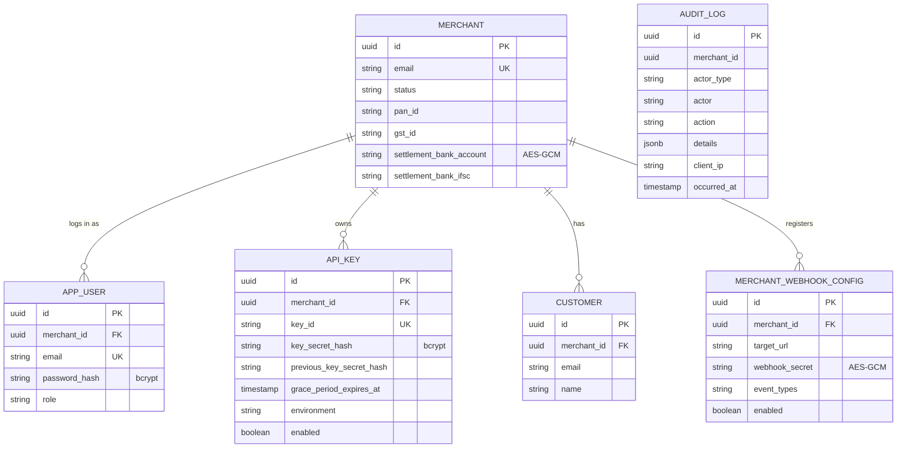
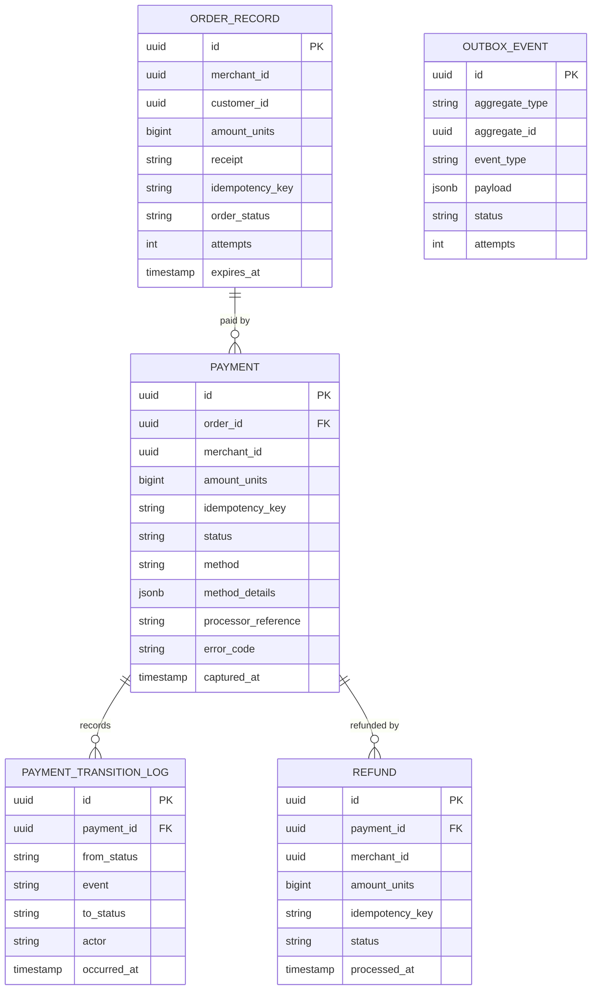
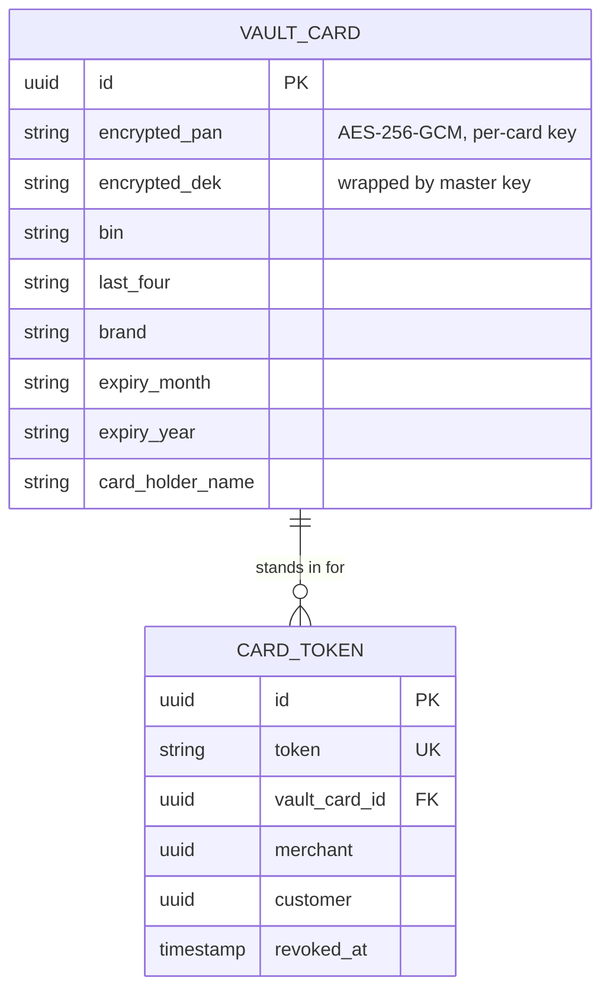
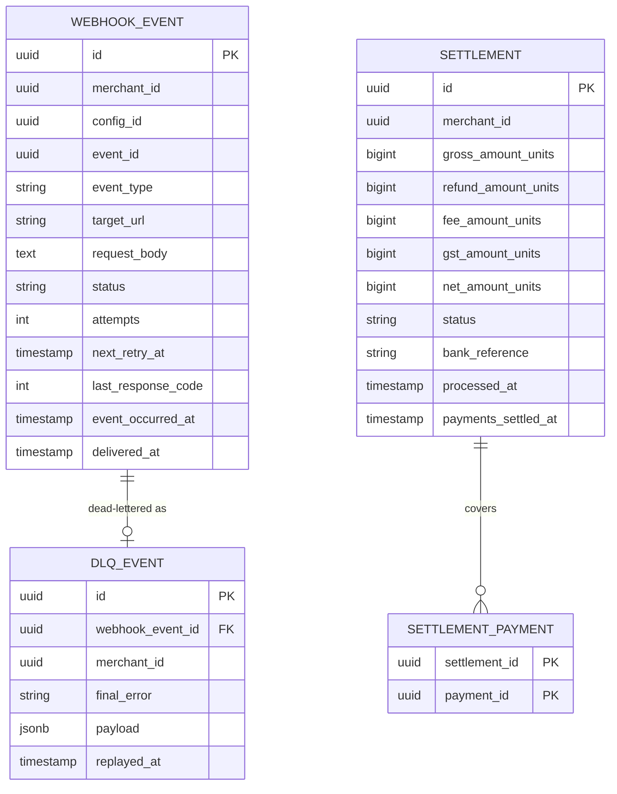

# Data Model

Four PostgreSQL databases, one per business service, 18 tables, 12 Flyway migrations. A reference into another service's data is a plain UUID with no foreign key and no join.

- [Conventions](#conventions)
- [merchant-service](#merchant-service-payflo_merchant)
- [payment-service](#payment-service-payflo_payment)
- [vault-service](#vault-service-payflo_vault)
- [operations-service](#operations-service-payflo_operations)
- [Cross-service references](#cross-service-references)
- [Enums](#enums)
- [Changing the schema](#changing-the-schema)

## Conventions

| Rule | Detail |
|---|---|
| Ids | UUIDs; time-ordered (v7) on payment-service's high-volume tables. `settlement_payment` has a composite key |
| Audit columns | Every entity extends `BaseEntity`: `created_at`, `updated_at`, `created_by`, `updated_by` (an API key id, `merchant_id: <uuid>` or `SYSTEM`) |
| Money | The `Money` embeddable: `amount_units` (integer, smallest unit, paise for INR) and `currency`. Never a float |
| Enums | `@Enumerated(STRING)` with an explicit length and a check constraint; all enums live in `common-lib` |
| Uniqueness | Enforced by unique indexes, not code: `(merchant_id, receipt)` and `(merchant_id, idempotency_key)` on orders, payments and refunds; `key_id`, `token`, emails. A violation is `409 DATA_INTEGRITY_VIOLATION` |
| Schema | Owned by Flyway; Hibernate runs with `ddl-auto: validate` |

## merchant-service (`payflo_merchant`)

| Table | Notes |
|---|---|
| `merchant` | The tenant. `status` is `PENDING_KYC` on signup, `ACTIVE` after KYC, `SUSPENDED` by the operator, with `status_before_suspension` restored on reactivation. The payout account number is encrypted and returned masked |
| `app_user` | Dashboard logins. An email is one login across the platform |
| `api_key` | `pf_<env>_<random>` with a bcrypt secret; the previous hash is accepted until `grace_period_expires_at` after a rotation. Revoking sets `enabled = false` |
| `customer` | Unique per `(merchant_id, email)`; found or created when an order carries a customer |
| `merchant_webhook_config` | One endpoint, subscribed to a comma-separated list of events or `ALL` |
| `audit_log` | Append-only: a trigger refuses `UPDATE`, `DELETE` and `TRUNCATE`. `action` and `actor_type` have check constraints. Secret-looking detail names are redacted before storage |

## payment-service (`payflo_payment`)

| Table | Notes |
|---|---|
| `order_record` | `order` is an SQL keyword. Unique `(merchant_id, receipt)` and `(merchant_id, idempotency_key)`. A partial index on `expires_at` covers only unpaid orders, for the expiry sweeper |
| `payment` | `status` moves only through the state machine. Unique `(merchant_id, idempotency_key)`. `(status, created_at)` serves the bank simulator's oldest-first query |
| `payment_transition_log` | Every status change, with event and actor (`SYSTEM`, `MERCHANT`, `CUSTOMER`) |
| `refund` | Refunds pending or processed add up to at most the payment's amount, checked under the payment's row lock |
| `outbox_event` | `PENDING` → `PUBLISHED`, or `FAILED` after 3 attempts and requeued after 5 minutes. Published rows are deleted after 7 days |

## vault-service (`payflo_vault`)

The only database that holds card data. A dump alone decrypts nothing: the data key is wrapped by a master key only vault-service is configured with. There is no CVV column. A token is chargeable only by the merchant that created it and only while `revoked_at` is null.

## operations-service (`payflo_operations`)

| Table | Notes |
|---|---|
| `webhook_event` | One delivery of one event to one endpoint. `request_body` is the exact string signed and sent. `next_retry_at` doubles as a two-minute lease during an attempt and mirrors the Redis queue. `event_occurred_at` starts the delivery-latency clock |
| `dlq_event` | A delivery that exhausted its attempts, or a Kafka record that couldn't become one |
| `settlement` | One merchant's payout per currency per run: `net = gross − refunds − fee − GST` |
| `settlement_payment` | Links each payout to the exact payments it covers |
| `outbox_event` | As in payment-service, for `SETTLEMENT_*` events |

## Cross-service references

| Column | Refers to |
|---|---|
| `order_record.merchant_id`, `payment.merchant_id`, `refund.merchant_id` | merchant-service `merchant` |
| `order_record.customer_id`, `card_token.customer` | merchant-service `customer` |
| `card_token.merchant` | merchant-service `merchant` |
| `webhook_event.merchant_id`, `webhook_event.config_id`, `dlq_event.merchant_id`, `settlement.merchant_id` | merchant-service |
| `settlement_payment.payment_id` | payment-service `payment` |

Scoping is by value: every order and payment query filters on `merchant_id` from `MerchantContext`.

## Enums

| Enum | Values |
|---|---|
| `MerchantStatus` | `PENDING_KYC`, `ACTIVE`, `SUSPENDED` |
| `BusinessType` | `LLP`, `PROPRIETORSHIP`, `PARTNERSHIP`, `PRIVATE_LIMITED`, `PUBLIC_LIMITED`, `TRUST` |
| `UserRole` | `OWNER`, `ADMIN`, `TEAM` |
| `Environment` | `TEST`, `LIVE` |
| `AuditAction` | `SETTLEMENT_BANK_CHANGED`, `KYC_VERIFIED`, `PASSWORD_CHANGED`, `API_KEY_CREATED`, `API_KEY_REVOKED`, `API_KEY_ROTATED`, `WEBHOOK_CONFIG_CREATED`, `WEBHOOK_CONFIG_UPDATED`, `WEBHOOK_CONFIG_DELETED`, `WEBHOOK_SECRET_ROTATED`, `USER_ADDED`, `USER_ROLE_CHANGED`, `USER_REMOVED`, `MERCHANT_SUSPENDED`, `MERCHANT_REACTIVATED`, `SETTLEMENT_RUN_TRIGGERED` |
| `AuditActorType` | `USER`, `API_KEY`, `PLATFORM_ADMIN`, `SYSTEM` |
| `OrderStatus` | `CREATED`, `ATTEMPTED`, `PAID`, `CANCELLED`, `EXPIRED` |
| `PaymentStatus` | `CREATED`, `AUTHORIZING`, `AUTHORIZED`, `CAPTURING`, `CAPTURED`, `FAILED`, `CANCELLED`, `REFUNDED`, `PARTIALLY_REFUNDED`, `SETTLED`, `AUTH_EXPIRED` |
| `PaymentEvent` | `AUTHORIZE_ATTEMPT`, `AUTHORIZE_SUCCESS`, `AUTHORIZE_FAIL`, `CAPTURE_REQUEST`, `CAPTURE_SUCCESS`, `CAPTURE_FAIL`, `CAPTURE_TIMEOUT`, `REFUND_INIT`, `REFUND_COMPLETE`, `REFUND_FAIL`, `SETTLE`, `CANCEL` |
| `PaymentMethod` | `CARD`, `NETBANKING`, `UPI`, `WALLET` |
| `PaymentActor` | `CUSTOMER`, `MERCHANT`, `SYSTEM` |
| `RefundStatus` | `PENDING`, `PROCESSING`, `PROCESSED`, `FAILED` |
| `CardBrand` | `VISA`, `MASTERCARD`, `RUPAY`, `AMEX` |
| `SettlementStatus` | `INITIATED`, `TRANSFER_PENDING`, `PROCESSED`, `FAILED` |
| `WebhookEventStatus` | `PENDING`, `DELIVERED`, `FAILED`, `DEAD` |
| `OutboxStatus` | `PENDING`, `PUBLISHED`, `FAILED` |
| `EventAggregateType` | `ORDER`, `PAYMENT`, `REFUND`, `SETTLEMENT` (selects the Kafka topic) |
| `ChaosMode` | `NORMAL`, `SLOW`, `FAILURE`, `SUCCESS`, `TIMEOUT` (simulator setting) |

The payment and settlement lifecycles are drawn in [architecture](architecture.md#payment-state-machine).

## Changing the schema

1. Add `V<next>__what_it_does.sql` in the owning service's `src/main/resources/db/migration`. Never edit an applied migration.
2. Change the entity to match. `contextLoads` runs every migration on an empty PostgreSQL and validates the entities, so a mismatch fails the build.
3. A new enum constant widens its check constraint in the same migration.
4. A reference to another service's data is a plain id.

| Service | Migrations |
|---|---|
| merchant | `V1__baseline`, `V2__suspension_and_audit_log`, `V3__drop_unused_columns` |
| payment | `V1__baseline`, `V2__payment_method_as_name`, `V3__order_idempotency_key`, `V4__index_review` |
| vault | `V1__baseline`, `V2__drop_unused_deleted_at` |
| operations | `V1__baseline`, `V2__webhook_signed_at_send`, `V3__webhook_event_occurred_at` |
