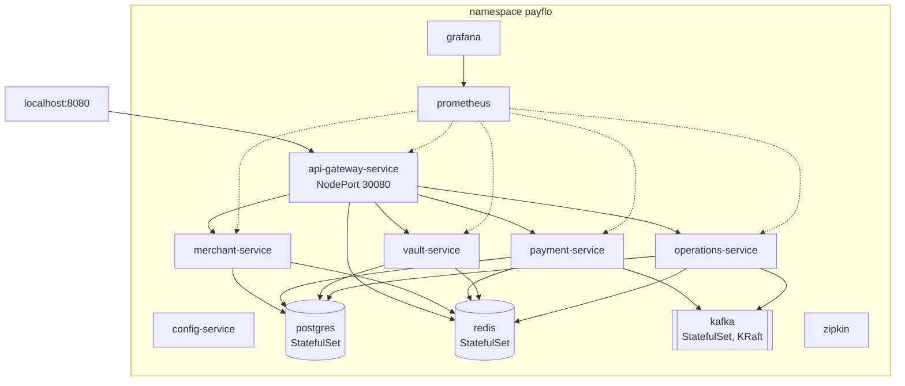

# Deployment

PayFlo runs on a local [kind](https://kind.sigs.k8s.io/) cluster: every service, PostgreSQL, Redis, Kafka and the observability stack in one namespace, assembled with Kustomize from `microservices/k8s/`. Kubernetes Services replace Eureka, and one PostgreSQL StatefulSet hosts the four databases, each with its own user.

- [Topology](#topology)
- [Running on kind](#running-on-kind)
- [Manifests](#manifests)
- [Configuration and secrets](#configuration-and-secrets)
- [Images](#images)
- [Scaling](#scaling)
- [Observability](#observability)

## Topology



| Property | How |
|---|---|
| One entry point | Only the gateway has a NodePort; every other Service is `ClusterIP` |
| No Dockerfiles | Jib builds each image from its `pom.xml` |
| Least secrets | Each pod gets only the secrets it needs; only vault-service gets `VAULT_MASTER_KEY` |
| Rolling updates | `RollingUpdate` with `maxUnavailable: 0`, a 5 s `preStop`, graceful shutdown, and a `PodDisruptionBudget` for the gateway and payment-service |

## Running on kind

```bash
cd microservices
./mvnw -DskipTests install
./mvnw -DskipTests jib:dockerBuild -pl config-service,merchant-service,vault-service,payment-service,operations-service,api-gateway-service
kind create cluster --config k8s/kind-config.yaml
for s in config-service merchant-service vault-service payment-service operations-service api-gateway-service; do kind load docker-image payflo/$s:latest --name payflo; done
cp k8s/secrets.env.example k8s/secrets.env
kubectl apply -k k8s                  # or k8s-scaled for three replicas
kubectl -n payflo get pods -w
```

Services fail fast and retry until config-service answers, so a few restarts on the first deploy are expected; everything is ready within a few minutes. The gateway is then on `http://localhost:8080`.

| Task | Command |
|---|---|
| Grafana, Prometheus, Zipkin | `kubectl -n payflo port-forward svc/grafana 3000:3000` (and `prometheus 9090`, `zipkin 9411`) |
| Kafka UI | `kubectl -n payflo port-forward svc/kafka-ui 8090:8090` |
| SQL shell | `kubectl -n payflo exec -it postgres-0 -- psql -U postgres -d payflo_payment` |
| Ship a code change | Rebuild the image, `kind load docker-image …`, `kubectl -n payflo rollout restart deploy/<service>` |
| Tear down | `kind delete cluster --name payflo` |

## Manifests

```
microservices/k8s/
  kustomization.yaml       resources, and the secretGenerator for app-secrets
  kind-config.yaml         one node named payflo; NodePort 30080 → localhost:8080
  secrets.env.example      copy to secrets.env (gitignored)
  infra/                   namespace, app-config ConfigMap
  stateful/                postgres, redis, kafka, kafka-ui
  services/                one Deployment + Service per application, pod disruption budgets
microservices/k8s-scaled/  overlay: 3 replicas of the gateway and payment-service, more room for the data tier
microservices/observability/  Zipkin, Prometheus, Grafana (shared with the local Compose stack)
```

| Component | Kind | Notes |
|---|---|---|
| `postgres` | StatefulSet, 10Gi | `max_connections=300`; an init script creates the four databases and users |
| `redis` | StatefulSet, 2Gi | `maxmemory 192mb`, `volatile-lru` |
| `kafka` | StatefulSet, 10Gi | Single KRaft broker |
| Applications | Deployment + Service | Requests 250m / 512Mi, limits 1 CPU / 1Gi; startup, readiness and liveness probes on `/actuator/health` (the gateway's on `9081`) |

## Configuration and secrets

Services read the same `config-repo/` files with the `k8s` profile, which adds `application-k8s.yaml` (Eureka off, in-cluster Redis and Kafka), each `<service>-k8s.yaml` (in-cluster datasource and user) and the gateway's routes to `http://<service>`. config-service runs with `native,k8s`.

| ConfigMap `app-config` | Value |
|---|---|
| `SPRING_PROFILES_ACTIVE` | `k8s` |
| `CONFIG_SERVER_URL` | `http://config-service.payflo.svc.cluster.local:8888` |
| `SPRING_CLOUD_CONFIG_FAIL_FAST`, retries | `true`, 20 attempts |
| `*_SERVICE_URI` | `http://<service>`, the Feign base URLs |
| `SERVER_ADDRESS` | `0.0.0.0` inside the pod |
| `TRACING_SAMPLING_PROBABILITY` | `0.1` |

| Secret `app-secrets` (from `secrets.env`) | Given to |
|---|---|
| `JWT_SECRET` | merchant-service, gateway |
| `VAULT_MASTER_KEY` | vault-service only |
| `WEBHOOK_SECRET_KEY` | merchant-service only |
| `INTERNAL_API_TOKEN` | every service |
| `ADMIN_API_KEY` | gateway only |
| `REDIS_PASSWORD` | Redis and every service |
| `POSTGRES_PASSWORD`, `<SERVICE>_DB_PASSWORD` | PostgreSQL and each service |
| `GRAFANA_ADMIN_PASSWORD`, `KAFKA_UI_PASSWORD` | Grafana, Kafka UI |

For a shared cluster, set real values in `secrets.env`, `ENFORCE_STRONG_SECRETS=true` and `WEBHOOK_ALLOW_PRIVATE_TARGETS=false`.

## Images

| Image | Notes |
|---|---|
| `payflo/config-service` | Bakes `config-repo/` in at `/config-repo` |
| `payflo/merchant-service`, `payment-service`, `vault-service`, `operations-service`, `api-gateway-service` | |

Base `eclipse-temurin:25-jre`, heap sized from the container limit (`-XX:MaxRAMPercentage=75`), tagged with the version and `latest`. Jib is not bound to a lifecycle phase: `jib:dockerBuild` builds into the local daemon, `jib:build -Dimage.prefix=<registry>` pushes. discovery-service isn't deployed because Eureka is off in-cluster.

## Scaling

```bash
kubectl apply -k microservices/k8s-scaled
kubectl -n payflo scale deploy/api-gateway-service deploy/payment-service --replicas=2
```

The overlay runs three replicas of the gateway and payment-service and gives the data tier room: PostgreSQL 4 CPUs and 3 GiB, Redis 1 CPU, Kafka 2 CPUs. Each replica keeps a limit of one CPU.

| Concern | Why replicas are safe |
|---|---|
| Gateway state | None: keys, counters, revocations and suspensions live in Redis |
| Two replicas on one payment | Row locks and the state machine; idempotency keys are unique in the database |
| Scheduled jobs | Every job holds a ShedLock, so it runs once |
| A pod stopping mid-request | Readiness probe, `preStop` sleep, graceful shutdown, `maxUnavailable: 0` |
| Database connections | 3 payment-service replicas use 120 of PostgreSQL's 300 with the other pools |

Measured throughput is in [results](results.md#horizontal-scaling).

## Observability

| Signal | Source | Where |
|---|---|---|
| Traces | Micrometer Tracing (Brave) in every service, through gateway, Feign, Redis and Kafka hops | Zipkin `:9411` |
| Metrics | `/actuator/prometheus` on every service (the gateway's on `9081`), with latency histograms | Prometheus `:9090` |
| Dashboard | `observability/grafana/dashboards/payflo-overview.json` | Grafana `:3000` |
| Logs | Standard output, each line with the trace and span id | `demo/logs/`, `kubectl logs` |

Locally, start the stack with `docker compose -f microservices/observability/docker-compose.yaml up -d`; on Kubernetes it is part of `kubectl apply -k`.

| Grafana row | Panels |
|---|---|
| Targets | Gateway throughput, p99, availability, share of requests under 1 s |
| Traffic and latency | Rate, p99 and 5xx per service; the slowest endpoints |
| Payments and events | Transitions by status, outbox backlog, webhook outcomes |
| Webhook SLA | Share delivered within 30 s, latency p50/p99, backlog and oldest waiting event |
| Runtime | Heap, connection pool use, CPU |

| PayFlo metric | Meaning |
|---|---|
| `payflo_payment_transitions_total{from,event,to}` | Every state-machine transition |
| `payflo_outbox_pending` | Events written but not yet published |
| `payflo_webhook_deliveries_total{outcome}` | `delivered`, `retry`, `dead` |
| `payflo_webhook_delivery_latency_seconds` | From the change to the merchant's `2xx`, with 30 s and 24 h buckets |
| `payflo_webhook_oldest_unattempted_age_seconds` | The SLA being missed right now, before any delivery shows it |
| `payflo_velocity_refused_total{rule}` | Card-testing refusals |

| Target | PromQL |
|---|---|
| Throughput | `sum(rate(http_server_requests_seconds_count{application="api-gateway-service",uri!~"/actuator.*"}[1m]))` |
| p99 | `histogram_quantile(0.99, sum by (le) (rate(http_server_requests_seconds_bucket{application="api-gateway-service",uri!~"/actuator.*"}[1m])))` |
| Availability | `1 - sum(rate(http_server_requests_seconds_count{application="api-gateway-service",status=~"5.."}[5m])) / sum(rate(http_server_requests_seconds_count{application="api-gateway-service"}[5m]))` |
