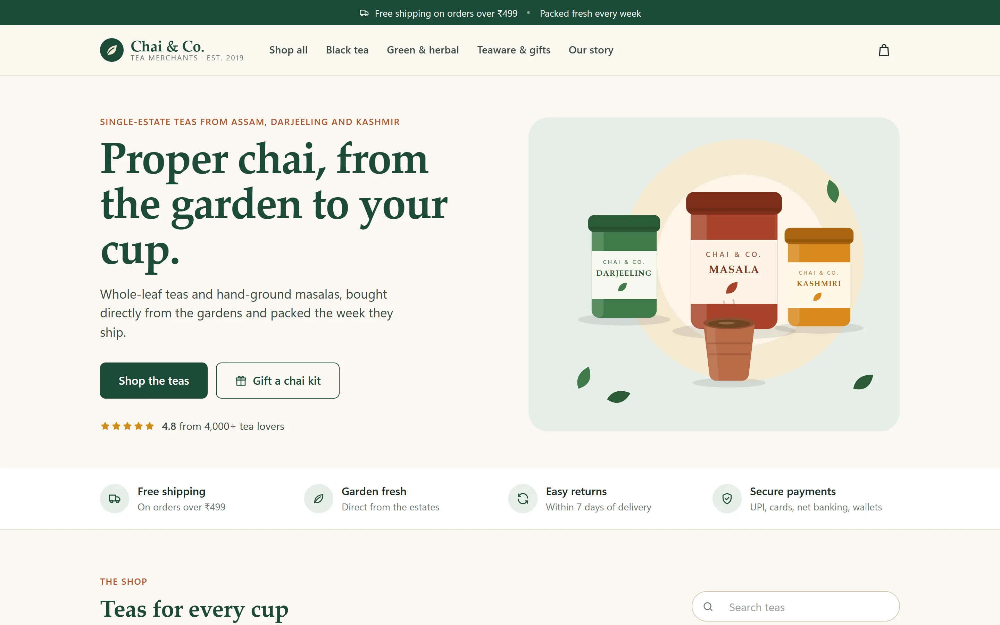
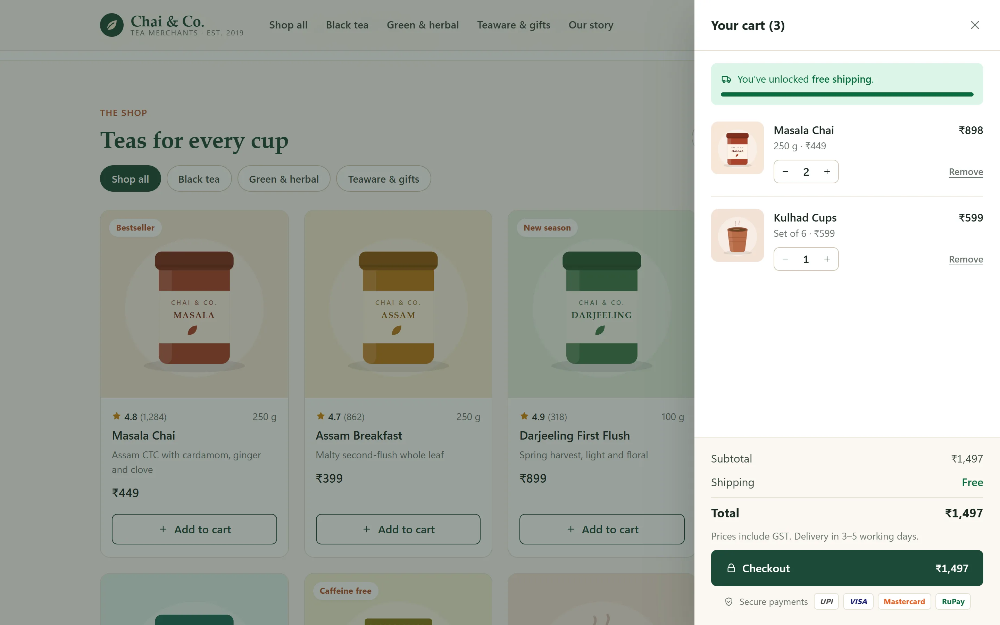
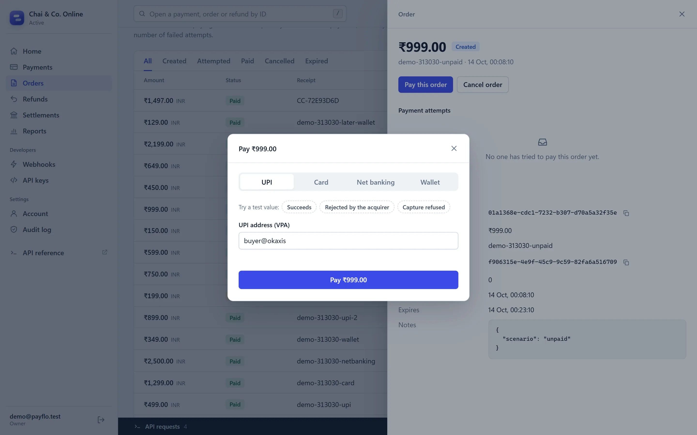
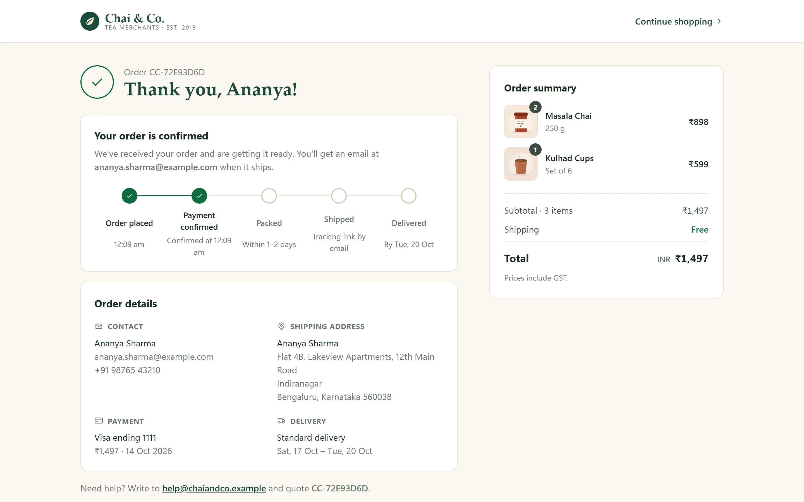

# Development

- [Prerequisites](#prerequisites)
- [The one-command demo](#the-one-command-demo)
- [The dashboard and the shop](#the-dashboard-and-the-shop)
- [Running by hand](#running-by-hand)
- [Configuration](#configuration)
- [Commands](#commands)
- [Testing](#testing)
- [Troubleshooting](#troubleshooting)
- [Resetting local data](#resetting-local-data)

## Prerequisites

| Tool | Version | For |
|---|---|---|
| JDK | 25 | Every service. Use the bundled wrapper (`./mvnw`, `mvnw.cmd` on Windows) |
| Docker | With Compose | PostgreSQL, Redis, Kafka, and Testcontainers in the tests |
| Python | 3.10+ | The demo, dashboard, shop, load-test and chaos scripts. Standard library only |
| kind, kubectl | Recent | Only for [Kubernetes](deployment.md) |

No external accounts: the bank is simulated and every secret has a development default in `config-repo/`.

## The one-command demo

```bash
cd microservices
python demo/demo.py
```

| Step | What it does |
|---|---|
| 1 | Starts PostgreSQL, Redis and Kafka and creates the four databases |
| 2 | Builds the jars if there are none |
| 3 | Starts discovery, config, the four business services and the gateway, in order, logging to `demo/logs/` |
| 4 | Serves the dashboard on <http://localhost:5173> |
| 5 | Seeds a demo merchant through the public API |
| 6 | Serves the merchant's shop on <http://localhost:5174> |

Every step is skipped when already done, so it is safe to re-run.

| Command | Does |
|---|---|
| `python demo/demo.py seed` | Another batch of orders and payments |
| `python demo/demo.py status` | What is running |
| `python demo/demo.py stop` | Stops what the script started; containers keep running |
| `python demo/demo.py --build` | Rebuilds the jars first |
| `python demo/demo.py --no-seed` | Starts everything without data |
| `python demo/demo.py --port-offset 100` | Moves every port by 100 (gateway 8180, dashboard 5273, shop 5274); remembered for later commands |

| The seed creates | To show |
|---|---|
| Signup, profile, payout account, KYC | `PENDING_KYC` → `ACTIVE` |
| An API key | Saved to `demo/.run/api-key.json` |
| A working and a failing webhook endpoint, plus the shop's | Deliveries, retries and `FAILED` attempts |
| Payments by every method | Authorization and capture within seconds |
| `fail@okaxis`, a declined card then UPI on one order | Test values and a second attempt |
| `capturefail@okaxis`, then a manual capture | A refused capture captured on retry |
| One order request sent twice with one key | One order |
| An unpaid and a cancelled order, a partial refund | The other statuses |
| A settlement run by the operator | `gross − refunds − fee − GST = net`, payments `SETTLED` |

The demo login is `demo@payflo.test` / `demo-password-1` (override with `DEMO_EMAIL`, `DEMO_PASSWORD`).

## The dashboard and the shop

Both are clients of the public API only: plain HTML, CSS and JavaScript modules, no build step, no dependencies, each with a loopback Python server.

| | Dashboard (`microservices/dashboard/`) | Shop (`microservices/storefront/`) |
|---|---|---|
| Who it is for | The merchant's staff, and the operator | The merchant's customers |
| What it shows | Home and reports, orders with a checkout, payments, refunds, settlements, webhooks, API keys, team, audit log, operator console | A tea shop with a cart, a checkout with PayFlo's embedded payment form, and a confirmation page |
| How it reaches PayFlo | `serve.py` forwards `/v1/**` to the gateway; the page holds the session in `sessionStorage` | `serve.py` is the merchant's backend: it holds the API key, prices the cart from its own list, creates the order and payment with idempotency keys, and verifies the signed webhook |
| Live updates | Home, Payments and Orders re-query every few seconds | The confirmation ticks when the signed webhook arrives |
| Run alone | `python dashboard/serve.py --gateway http://localhost:8080` | `python storefront/serve.py --gateway http://localhost:8080` |

| | |
|---|---|
|  |  |
| The shop | The cart, priced by the shop's server |
|  |  |
| The dashboard's checkout | The confirmation, after the signed webhook |

Neither needs a gateway change: no CORS, no static files, no extra public route. Both bind `127.0.0.1`, set a strict `Content-Security-Policy`, and build markup with text nodes, never `innerHTML`. The shop never logs a request body. Swagger UI is at <http://localhost:5173/docs.html>.

## Running by hand

```bash
docker compose -f services.docker-compose.yaml up -d
docker exec -it pgvector-payflo psql -U user -d postgres \
  -c "CREATE DATABASE payflo_merchant" -c "CREATE DATABASE payflo_payment" \
  -c "CREATE DATABASE payflo_vault" -c "CREATE DATABASE payflo_operations"
cd microservices && ./mvnw clean install -DskipTests
```

Start each service from its own module directory, one terminal each:

```bash
cd microservices/discovery-service && ../mvnw spring-boot:run     # :8761, first
cd microservices/config-service && ../mvnw spring-boot:run        # :8888, second
cd microservices/merchant-service && ../mvnw spring-boot:run      # :8081
cd microservices/payment-service && ../mvnw spring-boot:run       # :8082
cd microservices/vault-service && ../mvnw spring-boot:run         # :8083
cd microservices/operations-service && ../mvnw spring-boot:run    # :8084
cd microservices/api-gateway-service && ../mvnw spring-boot:run   # :8080, last
```

Then a first payment through the gateway:

```bash
curl -s localhost:8080/v1/auth/signup -H 'Content-Type: application/json' \
  -d '{"name":"Acme","email":"owner@acme.test","password":"password123"}'
TOKEN=$(curl -s localhost:8080/v1/auth/login -H 'Content-Type: application/json' \
  -d '{"email":"owner@acme.test","password":"password123"}' | jq -r .accessToken)
curl -s localhost:8080/v1/merchants/api-keys -H "Authorization: Bearer $TOKEN" \
  -H 'Content-Type: application/json' -d '{"environment":"TEST"}'
curl -s -u "$KEY_ID:$KEY_SECRET" localhost:8080/v1/orders -H 'Content-Type: application/json' \
  -d '{"amount":{"amountUnits":50000,"currency":"INR"},"receipt":"rcpt-1"}'
curl -s -u "$KEY_ID:$KEY_SECRET" localhost:8080/v1/payments -H 'Content-Type: application/json' \
  -d '{"orderId":"<order id>","method":"UPI","methodDetails":{"vpa":"buyer@okaxis"}}'
```

The payment returns `AUTHORIZING` and reaches `CAPTURED` within a few seconds.

| Process | Address |
|---|---|
| Gateway | <http://localhost:8080> (Actuator on `:9081`) |
| Eureka | <http://localhost:8761> |
| Config | `http://localhost:8888/<service>/default` |
| Services | `:8081`–`:8084` |
| Kafka Control Center | <http://localhost:9021> |
| PostgreSQL, Redis, Kafka | `:5432`, `:6380`, `:29092` |

## Configuration

Every setting lives in `microservices/config-repo/`: `application.yaml` for all services, `<service>.yaml` for one, `*-k8s.yaml` for the cluster. A module's own `application.yaml` holds only its name and `spring.config.import: configserver:…`.

| Variable | Default | Used by |
|---|---|---|
| `CONFIG_SERVER_URL`, `EUREKA_URL` | `http://localhost:8888`, `http://localhost:8761/eureka` | every service |
| `<SERVICE>_DB_URL`, `DB_USER`, `DB_PASS` | `jdbc:postgresql://localhost:5432/payflo_<service>`, `user`, `password` | business services |
| `<SERVICE>_DB_POOL_SIZE` | payment 40, merchant 20, operations 16, vault 10 | business services |
| `REDIS_HOST`, `REDIS_PORT`, `REDIS_PASSWORD` | `localhost`, `6380`, empty | gateway and business services |
| `KAFKA_BROKERS` | `localhost:29092` | payment, operations |
| `JWT_SECRET` | development value | merchant (signs), gateway (verifies) |
| `VAULT_MASTER_KEY` | development value | vault only |
| `WEBHOOK_SECRET_KEY` | development value | merchant only |
| `INTERNAL_API_TOKEN` | development value | every service |
| `ADMIN_API_KEY` | `dev-admin-api-key-change-me` | gateway only; blank turns the admin API off |
| `ENFORCE_STRONG_SECRETS` | `false` | `true` refuses to start on a development default |
| `WEBHOOK_ALLOW_PRIVATE_TARGETS` | `true` | `false` requires `https` and public webhook targets |
| `API_KEY_RATE_LIMIT_PER_MINUTE`, `JWT_RATE_LIMIT_PER_MINUTE`, `PUBLIC_AUTH_RATE_LIMIT_PER_MINUTE`, `MAX_FAILED_AUTH_PER_MINUTE` | `200`, `600`, `120`, `30` | gateway |
| `CLIENT_IP_HEADER` | empty | gateway, behind a proxy |
| `GATEWAY_TLS_ENABLED`, `GATEWAY_TLS_KEYSTORE`, `GATEWAY_TLS_KEYSTORE_PASSWORD` | `false` | gateway |
| `MAX_REQUEST_BODY_BYTES` | `1048576` | gateway |
| `SETTLEMENT_FEE_RATE`, `SETTLEMENT_GST_RATE`, `SETTLEMENT_HOLD_DAYS` | `0.02`, `0.18`, `0` | operations |
| `VAULT_VELOCITY_ENABLED`, `CARD_VELOCITY_ENABLED` | `true` | vault, payment |
| `ZIPKIN_URL`, `TRACING_SAMPLING_PROBABILITY` | `http://localhost:9411/api/v2/spans`, `1.0` | every service |
| `SERVER_ADDRESS` | `127.0.0.1` | every service; `0.0.0.0` in a pod |
| `REDIS_MAXMEMORY` | `768mb` | Redis, with `volatile-lru` so the retry queue is never evicted |

| Simulator setting | File | Default |
|---|---|---|
| `payment.simulator.chaos-mode` | `payment-service.yaml` | `NORMAL` |
| `payment.simulator.batch-size`, `concurrency` | `payment-service.yaml` | `50`, `4` |
| `payment.simulator.capture.failure-rate`, `failures-before-success` | `payment-service.yaml` | `0`, `1` |
| `settlement.simulator.*` | `operations-service.yaml` | `NORMAL`, 2–12 s, 95% success, 0% refused |

## Commands

On Windows use `mvnw.cmd`.

| Command (from `microservices/`) | Purpose |
|---|---|
| `./mvnw clean install -DskipTests` | Build every module and install `common-lib` |
| `./mvnw verify` | Every unit and integration test, as CI runs it |
| `./mvnw -pl <module> test` | One module's tests |
| `python ../docs/api/check_openapi.py` | The spec must match the controllers |
| `python chaos/crash_and_outage_test.py` | Crash and outage tests against the running stack |
| `./mvnw -DskipTests jib:dockerBuild -pl <module>` | A container image |
| `curl localhost:8888/<service>/default` | What config-service serves a service |
| `curl localhost:9081/actuator/health` | Gateway health (business services on their own ports) |
| `docker compose -f microservices/observability/docker-compose.yaml up -d` | Zipkin `:9411`, Prometheus `:9090`, Grafana `:3000` |
| `docker exec -it pgvector-payflo psql -U user -d payflo_payment` | A SQL shell |

## Testing

| Suite | Command | Covers |
|---|---|---|
| Unit | `./mvnw test -Dtest='!*IntegrationTest,!*ApplicationTests,!*Tests'` | Money, security and state logic with collaborators mocked |
| Integration | `./mvnw -pl <module> test` | Each service as the real application on real PostgreSQL, Redis and Kafka via Testcontainers; only other services are stubbed |
| Everything | `./mvnw verify` | Both, in every module. Needs only Docker |
| Crash and outage | `python chaos/crash_and_outage_test.py` | Kills a service or stops a data store under load. See [results](results.md#failure-testing) |
| Load and idempotency | `microservices/load-test/` | See [results](results.md#reproducing) |

| Integration test | Proves |
|---|---|
| Every `*ApplicationTests` | Flyway builds the schema on an empty database and Hibernate validates every entity |
| `PaymentFlowIntegrationTest` | Card and UPI through capture; declines, vault outage compensation, timed-out calls; refused captures retried; card testing on real Redis; one payment per order; refunds; idempotency with Redis and with the database backstop; tenant isolation; events on Kafka; analytics SQL |
| `SettlementIntegrationTest` | Amounts on a real database; declined, refused and unanswered payouts; no double payout; dependency outages; recovery after every step |
| `WebhookDeliveryIntegrationTest` | Signed delivery to a verifying receiver; tampering and replay rejected; retries re-signed; secret rotation; dead-lettering and replay; blocked targets; redirects refused; the SLA clock; 3,000 events in seconds |
| `VaultIntegrationTest` | Encryption at rest, no CVV column, token ownership, the service token, tokenization velocity |
| `MerchantIntegrationTest` | bcrypt, secrets shown once, refresh rotation, lockout, key rotation, tenant isolation, silent duplicate signup, the append-only audit log, the admin API |
| `AdminSettlementIntegrationTest` | The operator's settlement run: audited first, scoped, locked, and refused without the admin marker |

Unit tests cover, among others, the idempotency filter, card masking in logs, webhook URL validation, the internal token, secret enforcement at start-up, the gateway's auth filter and header stripping, the state machine, fee and GST arithmetic, the velocity guards, and `NoRemoteCallInTransactionTest`, which fails if a transactional bean in operations-service holds a client of another service.

CI (`.github/workflows/ci.yml`) runs on every push and pull request: the OpenAPI check, `./mvnw verify`, and a Trivy scan of a CycloneDX bill of materials that fails on a fixable HIGH or CRITICAL vulnerability or a committed secret.

## Troubleshooting

| Symptom | Fix |
|---|---|
| "Could not resolve placeholder", or empty config | Start config-service first, from `microservices/config-service`; check `curl localhost:8888/<service>/default` |
| `invalid value for parameter "TimeZone": "Asia/Calcutta"` | Run the JVM with `-Duser.timezone=Asia/Kolkata` |
| `database "payflo_merchant" does not exist` | Run the `CREATE DATABASE` command above |
| `NoClassDefFoundError` for a new `common-lib` class | `./mvnw install` again, or build with `-pl common-lib,<module>` |
| Port 8080 in use | `python demo/demo.py --port-offset 100`, or `--server.port=<port>` on the gateway |
| Gateway health answers `401` | Use the management port, `:9081` |
| `401` on every call | Log in again (100-minute JWT) or check the key |
| `429` under scripted traffic | Raise `API_KEY_RATE_LIMIT_PER_MINUTE` |
| A payment stays `AUTHORIZING` | Check `payment.simulator.chaos-mode` and payment-service's log |
| No webhook arrives | Check the endpoint's subscription, `webhook_event.last_response_code`, and `payflo_outbox_pending` |
| Kafka unreachable on `localhost:9092` | The host listener is `29092` |
| Slow scripts on Windows | Call `127.0.0.1`, not `localhost` |

## Resetting local data

This deletes every local merchant, key, payment and settlement.

```bash
docker compose -f services.docker-compose.yaml down -v
docker compose -f services.docker-compose.yaml up -d
```

Recreate the four databases, then start the services: Flyway rebuilds each schema. Reset Redis together with the databases, since cached API keys live there for up to 5 minutes.
