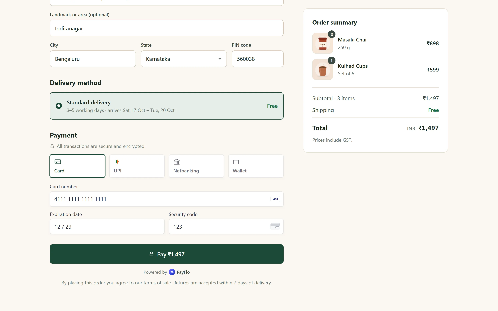
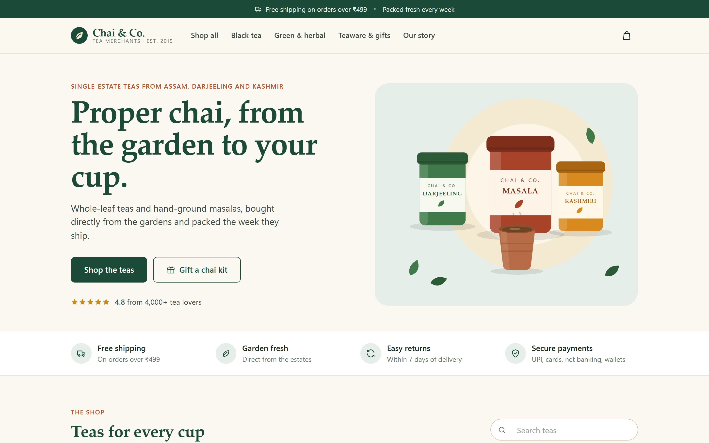
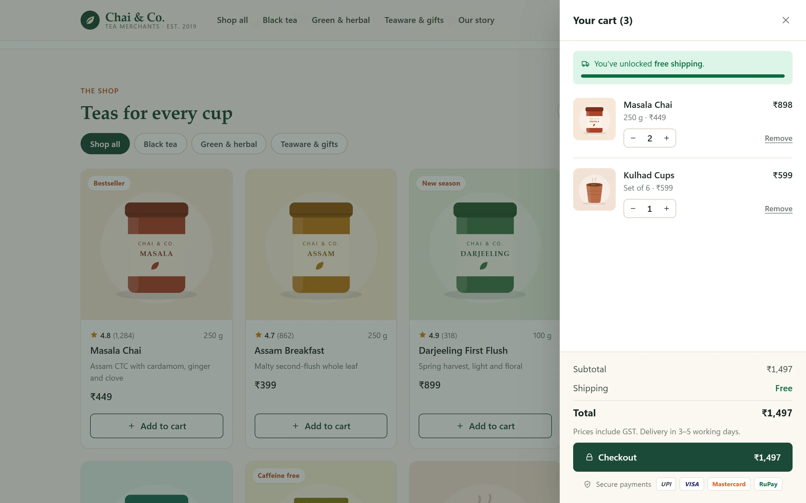
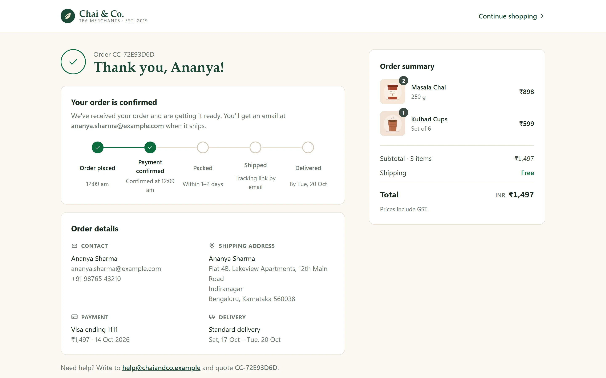

# The Demo, the Dashboard and the Shop

The quickest way to see PayFlo working: one command starts everything and fills it with a merchant's day, a web dashboard shows the result, and a sample shop lets you pay as a customer and watch the payment arrive. All three are for showing and exploring the system; none is part of it.

## One command

From `microservices/`, with Docker running and a JDK 25 on the path:

```bash
python demo/demo.py
```

It needs Python 3.10+ and nothing else (standard library only). Every step is skipped when it is already done, so it is safe to run again:

1. Starts PostgreSQL, Redis and Kafka and creates the four databases. A container that already exists is started as it is; one that doesn't is created from `services.docker-compose.yaml`.
2. Builds the jars if there are none (`--build` forces a rebuild, which a code change needs).
3. Starts discovery, config, the four business services and the gateway, in that order, waiting for each. Their logs go to `demo/logs/`.
4. Starts the dashboard on <http://localhost:5173>.
5. Seeds the demo merchant, through the gateway, the way a merchant's own code would.
6. Starts the demo merchant's shop on <http://localhost:5174>.

When it finishes it prints the dashboard's and the shop's addresses, the demo merchant's login and where the API key is.

| Command | Does |
|---|---|
| `python demo/demo.py` | Start what isn't running, seed, serve the dashboard and the shop |
| `python demo/demo.py seed` | Add another batch of orders and payments to the running stack |
| `python demo/demo.py status` | What is up |
| `python demo/demo.py stop` | Stop the services, the dashboard and the shop **this script started** (the containers are left running) |
| `python demo/demo.py --no-seed` | Start everything, create no data (the shop starts only if an earlier seed left the API key) |
| `python demo/demo.py --build` | Rebuild the jars first |
| `python demo/demo.py --port-offset 100` | Move every port by 100, for a machine where the usual ones are taken |

### What the seed creates

| Step | Shows |
|---|---|
| Signup, profile, payout account, KYC | A merchant going from `PENDING_KYC` to `ACTIVE` |
| An API key | Saved in `demo/.run/api-key.json` (gitignored), since the secret is shown only once |
| Two webhook endpoints | One that works (operations-service's test receiver) and one that fails, so retries and `FAILED` deliveries are visible |
| The shop's webhook endpoint | `PAYMENT_STATUS_CHANGED` to the shop's server, with the signing secret saved in `demo/.run/storefront.json` (gitignored) for it to check deliveries against |
| A `TEAM` user | A read-only login |
| Payments by UPI, card, net banking and wallet | The simulated bank authorizing and capturing within seconds, and declining some on its own |
| `fail@okaxis`, a declined card then UPI on the same order | The [test values](../api/mock-acquirer.md), and two attempts on one order |
| `capturefail@okaxis`, then a manual capture | A refused capture left `AUTHORIZED`, captured on retry |
| The same order request twice with one idempotency key | One order |
| An unpaid and a cancelled order | The other order statuses |
| A partial refund | `PARTIALLY_REFUNDED`, and the refund netted out of the payout |
| A settlement run by the operator | Gross − refunds − fee − GST = net, and the payments `SETTLED` |
| A few more payments afterwards | Captured and not yet settled, so a refund can be tried from the dashboard |

The outcome of an ordinary payment is the simulated bank's to decide (it declines about one net-banking payment in five), so the seed reports what happened rather than assuming it.

### Ports already taken

The script refuses to start a service on a port another program holds, and says which. It does not take "something answered on 8761" as proof that PayFlo's discovery-service is running: any Eureka answers there, and registering with another project's registry would quietly break both. Either stop the other program or move PayFlo:

```bash
python demo/demo.py --port-offset 100     # gateway :8180, services :8181-8184, discovery :8861, config :8988, dashboard :5273, shop :5274
```

The offset is remembered (in `demo/.run/settings.json`), so `seed`, `status` and `stop` find the same stack; `--port-offset 0` goes back. The services find discovery and config on their moved ports through `EUREKA_URL` and `CONFIG_SERVER_URL`.

### Development values

The demo merchant's login, and the admin key the seed uses for the settlement run, are development-only values, like every default in `config-repo`. Override them with `DEMO_EMAIL`, `DEMO_PASSWORD` and `ADMIN_API_KEY`. Don't point the script at a shared environment.

## The dashboard

`microservices/dashboard/` is a static page (`site/`: plain HTML, CSS and JavaScript modules, no build step and no dependencies) and a small server:

```bash
python dashboard/serve.py                       # http://localhost:5173 -> the gateway on :8080
python dashboard/serve.py --port 5273 --gateway http://localhost:8180
```

It is one more client of the public API. Everything it shows comes from the same endpoints a merchant's backend calls, and the **API requests** bar along the bottom of the page lists each call it makes, with the status, the time and the credential used.

It is laid out like a payments product's dashboard: the business and its sections in a sidebar, lists with a tab per status and the amount leading each row, and a row opening a drawer from the right with the amount, a timeline of what happened, and the actions that apply. The box in the top bar opens a payment, order or refund from a pasted ID (`/` puts the cursor in it).

The frame is exactly the height of the window and never scrolls: the sidebar and the API requests bar stay where they are, and only the content between them moves.

| Section | What it exercises |
|---|---|
| Home, Reports | The [analytics](../api/analytics.md) endpoints: today's net volume, a seven-day trend with a value at each point, the method breakdown, and a report over any range (with presets for the last 7, 30 and 90 days and 12 months). For a merchant that isn't set up yet, Home also lists what is left: profile, payout account, KYC, an API key, a webhook endpoint, a first payment, each read from the API |
| Orders | Create (with an idempotency key), read, cancel, and **Pay**: a checkout with the mock acquirer's test values one click away, which follows the payment until the bank answers |
| Payments, Refunds | Read, capture a refused capture again, refund in full or in part |
| Settlements | Each payout and how its net amount is reached |
| Webhooks | Endpoints (create, pause, rotate the secret, delete) and deliveries (payload, attempts, replay) |
| API keys | Create, roll the secret with a grace period, revoke; and the test values |
| Account | Profile, payout account, KYC, team users, password |
| Audit log | The merchant's own entries |
| **Operator** (a separate login, with the admin key) | Merchants (suspend, reactivate), a settlement run on demand, the audit log across merchants |

Log in as the demo merchant, as its `TEAM` user to see a read-only login refused by the gateway (`403 ROLE_FORBIDDEN`), or create a new account from the login page.

**Home, Payments and Orders are live.** Each asks the API again every few seconds while it is on screen (marked **Live** beside its Refresh button), and a row that is new, or whose status has changed, is tinted for a moment. Nothing is pushed: it is the same `GET` a refresh makes, so the gateway needed no change. These repeats are left out of the API requests bar, which would otherwise show nothing else.

### How it is put together

| File | Holds |
|---|---|
| `site/app.css` | Every style. Colours are tokens (`--brand`, `--text`, `--good-bg`, ...), defined once for light and again under `[data-theme="dark"]`; a component never names a colour itself |
| `site/js/ui.js` | The shared pieces: tables and paged lists (and their live reload), badges, forms, dialogs and drawers, toasts, the trend chart |
| `site/js/icons.js` | The icons and the logo, as inline SVG |
| `site/js/api.js` | The only code that calls the backend: sessions, token refresh, the request log |
| `site/js/app.js` | Login, the shell (sidebar, top bar, routing), the API requests bar |
| `site/js/views/` | One file per area: `analytics`, `orders` (and the checkout), `payments`, `operations` (settlements, webhooks), `account`, `operator` |

Markup is built with `createElement` and text nodes, never `innerHTML`: receipts, notes, webhook payloads and error text come from the API and must not be able to become markup.

One layout trap worth knowing: content hidden for screen readers (`.sr-only`) goes on a block wrapper, never on a `<table>`. A table can't be made smaller than its content, so one "hidden" at 1 px keeps its full height and, being absolutely positioned, stretches the page far past its end. The chart's data table did exactly that on the Reports page.

### How it reaches the API

A browser may only call the origin a page came from, so `serve.py` answers the page's `/v1/**` (and `/webhook/**`) calls by passing them to the gateway unchanged. That is why the gateway needed no change for the dashboard: no CORS, no static files, no new public route, and its strict `Content-Security-Policy` stays as it is.

- It listens on `127.0.0.1` only, like every other PayFlo process, and forwards a fixed list of headers (`Authorization`, `Content-Type`, `Accept`, `X-Idempotency-Key`, `X-Admin-Key`). Identity headers are not in the list, and the gateway drops them anyway.
- It never forwards `/internal/**`, stores nothing, and logs one line per API call: the method, path and status, never a header or a body.
- The page keeps the session (the JWT and refresh token, or the admin key) in `sessionStorage`, so closing the tab ends it. The only thing it remembers longer is the theme (light by default, dark from the button in the top bar), in `localStorage`. Its own `Content-Security-Policy` allows scripts and styles from itself only.

## The shop

`microservices/storefront/` is the other side of PayFlo: a merchant's website, where a customer pays. It is the demo merchant's tea shop, "Chai & Co.", and it integrates the way a real merchant does: its own server holds the API key and calls PayFlo, and its checkout embeds PayFlo's payment form. `demo.py` starts it on <http://localhost:5174> (5274 with `--port-offset 100`) once the seed has created the merchant's API key. To run it on its own against a gateway that is already up:

```bash
python storefront/serve.py                      # http://localhost:5174 -> the gateway on :8080
python storefront/serve.py --port 5274 --gateway http://localhost:8180
```



### Paying in the shop

1. **Pick something.** Open the shop, add a product to the cart (or open it for its details first) and press **Checkout**. Orders under ₹499 pay ₹49 shipping, and the cart shows how far an order is from free shipping.
2. **Give the delivery details.** Any email, a 10-digit mobile number starting with 6 to 9, an address, a state and a 6-digit PIN code. The shop's server checks them before a payment can start.
3. **Pay.** Choose a method in the payment form and enter a value from the table below; a card takes any future expiry and any three-digit CVC. While the bank answers, the form shows the wait in place of its fields.
4. **Watch it arrive.** The confirmation page opens with the order number and a tracker, and **Payment confirmed** ticks a moment later, when PayFlo's signed webhook reaches the shop's server. With the dashboard's Payments page open beside the shop, the payment appears there on its own and moves from authorizing to captured.

| Method | Enter | What happens |
|---|---|---|
| Card | `4111 1111 1111 1111` | Approved and captured within a few seconds |
| Card | `4000 0000 0000 0002` | Declined: the checkout says so, and the same order can be paid again |
| Card | `4000 0000 0000 0069` | Declined as an expired card |
| Card | `4000 0000 0000 0341` | Approved, but the bank refuses the first capture; the shop's server captures it again and the order goes through |
| UPI | `buyer@okaxis`, or any other `name@bank` | Approved after the "approve in your UPI app" wait |
| UPI | `fail@okaxis` | Rejected |
| UPI | `capturefail@okaxis` | Like the card above: the first capture refused, the retry captured |
| Net banking, wallet | Any bank or wallet in the list | Approved after a few seconds |

Like a real bank, the [simulated one](../api/mock-acquirer.md#2-the-bank-callback--the-asynchronous-answer) also declines a share of ordinary payments at random: about 1 card payment in 10, 1 UPI or wallet payment in 20 and 1 net-banking payment in 5. Such a decline reads "Your bank declined the payment", and paying again works.

| | |
|---|---|
|  |  |
| The shop | The cart |
|  |  |
| The checkout and PayFlo's payment form | The confirmation, after the signed webhook |

| Page | What it is |
|---|---|
| `/` | The shop: eight teas and teaware with category filters, search, a product view and a cart drawer |
| `/checkout.html` | The shop's checkout: contact (email, mobile), delivery address, the order summary, and PayFlo's payment form (`js/payflo.js`), embedded the way a payment SDK's element is: tabs for card, UPI, net banking and wallet, card-brand detection, errors beside the field they are about, and the wait for the bank. Coming back to the page while the bank is still answering shows that wait again |
| `/success.html` | The order confirmation: the order number, a tracker whose **Payment confirmed** step ticks when PayFlo's signed webhook reaches the shop's server, the contact, address and payment method, and the order summary |

### How it is put together

`serve.py` is the merchant's backend, and the only thing that talks to PayFlo. The pages talk to `serve.py`.

| Step | Call to the gateway, with the API key |
|---|---|
| The customer gives their details | Nothing yet: `serve.py` checks the email, mobile number, address and PIN code itself and keeps them with the checkout |
| The customer pays | `POST /v1/orders`, for an amount the server works out from its own price list and shipping rule; the browser sends product ids and quantities, never an amount. The customer's name, email and phone go with it. The checkout's id is the `X-Idempotency-Key`, so pressing Pay twice makes one order |
| A card | `POST /v1/vault/tokenize`, then the payment carries only the token. The number passes through `serve.py` on its way to the vault and is neither kept nor logged |
| The payment | `POST /v1/payments`, with a new idempotency key for each attempt; a declined attempt can be followed by another on the same order |
| Waiting for the bank | `GET /v1/payments/{id}` about once a second, while the page shows the bank's progress |
| A capture the bank refused | `POST /v1/payments/{id}/capture`, once, before the customer is told anything |
| Afterwards | PayFlo `POST`s `PAYMENT_STATUS_CHANGED` to the shop's `/webhooks/payflo`. The server checks the timestamp and the HMAC signature against its secret, drops an event id it has already seen, and only then marks the order confirmed (see [webhook configs](../api/webhook-configs.md#what-a-delivery-looks-like)) |

- The API key stays on the server (`demo/.run/api-key.json`, or `PAYFLO_KEY_ID` and `PAYFLO_KEY_SECRET`). The browser holds only its checkout's id, a random token that opens that one checkout.
- A decline is shown the way a checkout would say it ("Your card was declined") rather than as the API's `errorCode`, and the same order can be paid again by another method.
- Like the dashboard it listens on `127.0.0.1` only, needs no change to the gateway, and is plain HTML, CSS and JavaScript modules with no build step and no dependencies; its `Content-Security-Policy` allows scripts and styles from itself only, so the product pictures are drawn as inline SVG.
- Checkouts are kept in memory: restarting `serve.py` forgets the open ones, and the orders and payments stay in PayFlo.

## API reference in the browser

<http://localhost:5173/docs.html> renders [`docs/api/openapi.yaml`](../api/openapi.yaml) with Swagger UI, and "Try it out" calls the real API through the same server. Swagger UI itself is loaded from a CDN, so that page needs an internet connection; the spec does not. See the [API reference](../api/README.md#openapi-and-postman).
