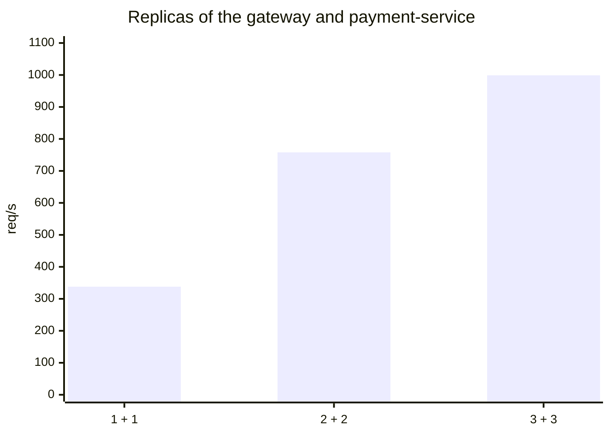

# Results

Measured on one laptop (32 logical cores, 16 GB for Docker) that also ran the load generator, PostgreSQL, Redis, Kafka and all seven services. Load tests run 100 virtual users for 3 minutes through the gateway, each a merchant backend creating orders and paying them by UPI, net banking or card.

- [Headline](#headline)
- [Engineering improvements](#engineering-improvements)
- [Webhook delivery](#webhook-delivery)
- [Horizontal scaling](#horizontal-scaling)
- [Failure testing](#failure-testing)
- [Idempotency](#idempotency)
- [Reproducing](#reproducing)

## Headline

| Measure | Result |
|---|---|
| Throughput | **1,272 req/s**, 5× the first build (250 req/s) |
| p99 latency | **171 ms** for the slowest request type, from 502 ms |
| Errors under load | **0** in 227,613 requests |
| Webhooks delivered within 30 s | **99.85%**, from 5.4% |
| Horizontal scaling | **3.0×** throughput on 3 replicas |
| Crash and outage scenarios | **7 of 7**: no payment lost, duplicated or stuck |
| Duplicate requests that took effect | **0 of 33,600** |

## Engineering improvements

Each bottleneck was found by running the load test and reading the Grafana dashboard, and each fix was measured with the same test.

| Improvement | Before | After |
|---|---|---|
| **Gateway proxy pool.** The gateway's HTTP client allowed 5 connections per route; raised to 200 (1,000 total) | An order took ~370 ms at the gateway against ~25 ms in payment-service | Queue removed; load reaches the services |
| **Connections held only inside transactions.** Open-Session-In-View off, pools sized per service with a 5 s acquisition timeout, order creation's customer lookup moved before its transaction | Connections held idle across remote calls | No connection held across a network call |
| **Circuit breakers scoped to remote failures.** A local pool timeout no longer opens a healthy dependency's breaker | Bursts of `503` under load | 0 errors |
| **Outbox published in acknowledged batches**, one `UPDATE` per batch, with an index for the poller | Backlog peaked at 89,000 events | Under 1,600 pending at ~1,500 events/s |
| **PostgreSQL tuned for write load**: 2 GB shared buffers, larger WAL budget, group commit | 660 req/s | 963 req/s |
| **Bank answers resolved in batches** of 50 per transaction, four batches at once | 56% of payments answered when the run ended; 212 captures/s | **96.3%** answered; **505 captures/s**; backlog clears in 14 s |
| **Redundant writes removed.** Outbox rows no longer re-updated after insert; payments inserted already `AUTHORIZING` | 5.2 ms of database time per payment | **3.3 ms** |
| **Partial index** for the order-expiry sweeper (unpaid orders only) | Full scan of 2.2 million orders, 655 ms | **0.05 ms** |
| **Time-ordered UUID v7 ids** on payment-service's high-volume tables | Random inserts across the whole index | Inserts land on recent index pages |
| **Webhook pipeline batched** end to end (below) | 5.4% within 30 s | **99.85%** within 30 s |

Together: **250 → 1,272 req/s** and **p99 502 → 171 ms**, with payment capture now running inside the test rather than after it.

## Webhook delivery

Every one of 50 merchants subscribed, measured from the change to the merchant's `2xx`.

| | Before | After | After, every event subscribed |
|---|---|---|---|
| Delivered | 26,259 | 91,644 | **283,486** (~1,575/s) |
| **Within 30 s** | 5.4% | **99.85%** | **100.0%** |
| Latency p50 / p99 | 5 min / 1 h | **1 s / 2 s** | 2 s / 2 s |
| Throughput, p99 | 794 req/s, 286 ms | 1,023 req/s, 245 ms | 1,039 req/s, 275 ms |

| Change | Effect |
|---|---|
| Kafka consumer takes a whole poll (up to 500 records) in one transaction and one Redis call | Consumer lag stays at zero |
| Deliveries claimed in batches, sent concurrently on virtual threads, successes recorded in one `UPDATE` | Database cost per delivery halved; a slow merchant delays only its own batch |
| Pooled JDK `HttpClient` with keep-alive, redirects refused | No ephemeral-port exhaustion; no redirect around the URL check |

## Horizontal scaling

A single-node kind cluster, 200 virtual users for 3 minutes, each replica limited to one CPU.



| Replicas | req/s | Against one | Errors |
|---|---|---|---|
| 1 and 1 | 338 | 1.0× | 0 |
| 2 and 2 | 758 | 2.2× | 0 |
| 3 and 3 | **999** | **3.0×** | 0 |

A rolling restart of both services under load kept **99.992%** of 226,834 requests successful at 1,133 req/s. Afterwards, across 408,000 payments: no order with two live payments, no idempotency key used twice, none stuck `AUTHORIZING`, the outbox empty.

## Failure testing

`python chaos/crash_and_outage_test.py` hard-kills a service or stops a data store while 36 customers pay, each retrying with an idempotency key, then checks the database: one order per customer, one payment per order, nothing lost, nothing stuck, money consistent, outbox drained, every webhook delivered.

| Scenario | Result | Payment flowing again after recovery | Everything settled |
|---|---|---|---|
| Kill payment-service | All 8 checks pass | 4.1 s | 6.9 s |
| Kill vault-service (every payment by card) | All 8 checks pass; the saga compensates, nothing charged | 1.9 s | 0.6 s |
| Kill the gateway | All 8 checks pass | 3.3 s | 6.8 s |
| Kill operations-service | All 8 checks pass; webhooks delayed, none lost | 3.0 s | 0.6 s |
| Stop Kafka | All 8 checks pass; the outbox holds every event | 2.4 s | 21.3 s |
| Stop Redis | All 8 checks pass | 10.2 s | 16.9 s |
| Stop PostgreSQL | All 8 checks pass | 12.8 s | 20.1 s |

Settlement interrupted after any of its steps is covered by `SettlementIntegrationTest`: the recovery job finishes it and nothing is paid twice.

## Idempotency

`idempotency_replay_test.py` sent each request 25 times under one key, 20 of them at the same instant.

| Request | Keys | Duplicate requests | Took effect |
|---|---|---|---|
| `POST /v1/payments` | 1,000 | 24,000 | **0** |
| `POST /v1/orders` | 400 | 9,600 | **0** |

## Reproducing

```bash
cd microservices
./mvnw verify                                   # 633 tests
python demo/demo.py                             # start and seed the stack
python chaos/crash_and_outage_test.py
cd load-test
python provision_keys.py --merchants 50
python run_load_test.py --threads 100 --rampup 20 --duration 180
python idempotency_replay_test.py --payments 1000 --order-keys 400 --merchants 20
```

Run the services with `API_KEY_RATE_LIMIT_PER_MINUTE=10000000` and `TRACING_SAMPLING_PROBABILITY=0.1`, and JMeter 5.6 on Java 17 or 21 (`JMETER_JAVA`). Each run writes a JMeter HTML report and a `summary.json` to `load-test/results/`. Absolute numbers depend on the hardware.
