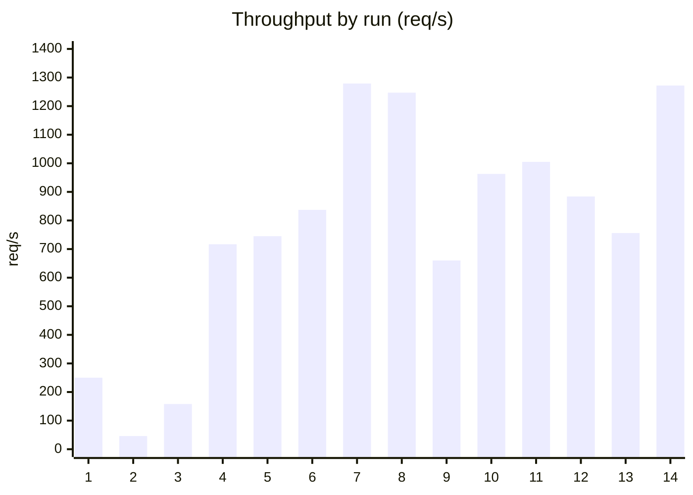
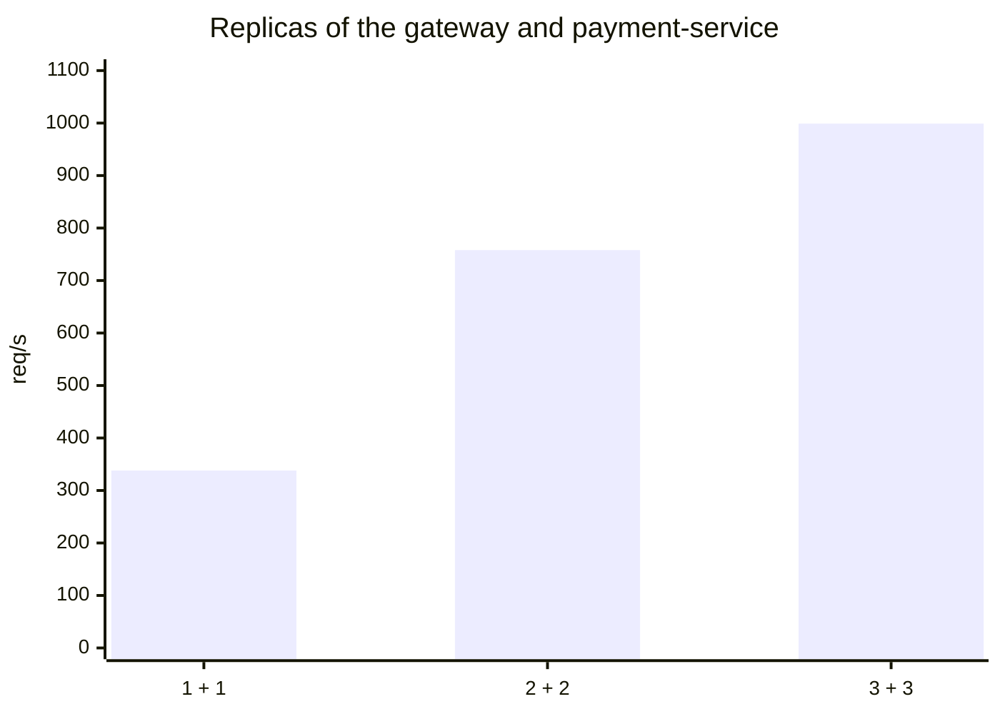
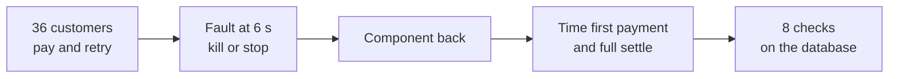

# Results

Every figure here was measured, with the command to re-measure it. The load-test runs span 2026-09-26 to 2026-10-07 (the final and scaling runs are from 2026-10-07), and the crash and outage runs are from 2026-10-16. Everything ran on one laptop (32 logical cores, 16 GB for Docker) that also ran the load generator, PostgreSQL, Redis, Kafka and all seven services.

- [Headline](#headline)
- [Load test](#load-test)
- [How throughput grew](#how-throughput-grew)
- [Webhook delivery](#webhook-delivery)
- [Database work per payment](#database-work-per-payment)
- [Horizontal scaling](#horizontal-scaling)
- [Crash and outage tests](#crash-and-outage-tests)
- [Idempotency under concurrent retries](#idempotency-under-concurrent-retries)
- [Quality and codebase](#quality-and-codebase)
- [Reproducing](#reproducing)

## Headline

| Measure | Target | Measured |
|---|---|---|
| Throughput | As much as one machine gives | **1,272 req/s** (≈ 636 orders + 636 payments a second) |
| p99 latency | < 1 s | **171 ms** for the slowest request type |
| Errors under load | 0 | **0** in 227,613 requests |
| Webhooks within 30 s | 99% | **99.85%** of 91,644 events, p99 under 2 s |
| Scaling, 1 → 3 replicas | — | **338 → 758 → 999 req/s (3.0×)** |
| Rolling restart under load | 99.99% | **99.992%** (19 failed of 226,834) |
| Crash and outage scenarios | Nothing lost, duplicated or stuck | **7 of 7 pass all 8 checks** |
| Duplicate requests that took effect | 0 | **0** of 33,600 |
| Tests | All passing | **633** |

## Load test

100 virtual users for 3 minutes through the gateway, each a merchant backend creating an order and paying it (40% UPI, 30% net banking, 30% card), with the rate limit raised and tracing sampled at 10%.

| Measure | Measured |
|---|---|
| Throughput | **1,272 req/s**; 1,023 req/s with a webhook for every payment |
| p99, slowest type | **171 ms**; 245 ms with webhooks |
| Errors | **0** in 227,613; 0 in 183,141 with webhooks |
| Payments answered by the bank before the run ended | **96.3%**, 505 captures a second; the rest are inside the simulated bank's 1–10 s delay |
| Backlog after the run | Cleared in 14–17 s |
| Outbox | About 1,500 events a second published, under 1,500 pending at any time |
| Database time per payment | **3.3 ms**, from 5.2 ms |

At this rate the machine is the limit, not a service: total CPU sits at about 96% of 32 cores, shared by the Docker VM, JMeter, the network proxy and the JVMs.

## How throughput grew

The first run managed 250 req/s at a p99 of 502 ms. Nineteen fixes later it reached 1,272 req/s, each found by running the test and reading the dashboard. Runs 1–8 count accepted requests with capture deferred; from run 9 capture runs inside the test.



| Run | Change | req/s | p99 | Errors | What the metrics showed |
|---|---|---|---|---|---|
| 1 | Baseline | 250 | 502 ms | 0% | Requests queued inside the gateway's 5-connection proxy pool |
| 2 | Gateway pool raised to 200 per route | 44–47 | 30 s | 85–91% | payment-service's 10-connection database pool ran out; requests waited the full 30 s for a connection |
| 3 | Pools sized, 5 s acquisition timeout, open breaker as `503` | 158 | 5.7 s | 54% | Pool connections idle in PostgreSQL, held by the application |
| 4 | Open-Session-In-View off | 717 | 647 ms | ~0% | Outbox backlog peaked at 89,000 |
| 5 | Outbox published in acknowledged batches | 745 | 611 ms | 1.2% | A pool timeout counted as a merchant-service failure |
| 6 | Breakers count only remote failures | 837 | 247 ms | 0% | Order creation held a connection across the customer lookup |
| 7 | Receipt check moved into the transaction; group commit | 1,279 | 160 ms | 0% | Outbox events left unpublished after the run |
| 8 | Outbox index, one `UPDATE` per batch, scheduler pool | 1,247 | 161 ms | 0% | Webhook consumer lag 194,000; payments left `AUTHORIZING` |
| 9 | Webhook targets cached; capture moved inside the run | 660 | 373 ms | 0% | PostgreSQL now the constraint |
| 10 | PostgreSQL given 2 GB cache and a larger WAL budget | 963 | 228 ms | 0% | Sessions waiting on WAL flush |
| 11 | Time-ordered UUID v7 ids | 1,005 | 267 ms | 0% | Within run-to-run variation |
| 12 | Audit log, velocity guards, request fingerprinting added | 884–920 | 255 ms | 0% | 56% answered by the end of the run |
| 13 | Bank answers resolved 50 per transaction | 756 | 362 ms | 0% | 96.5% answered by the end |
| 14 | Redundant writes and indexes removed, sweeper index, batched webhook pipeline, pooled HTTP client | **1,272** | **171 ms** | **0%** | 96.3% answered, 505 captures a second |

## Webhook delivery

Every one of 50 merchants subscribed, measured from the change (the outbox row's creation) to the merchant's `2xx`, over a 3-minute run and the drain after it.

| | Before | After | After, every event subscribed |
|---|---|---|---|
| Deliveries | 26,259 delivered, 7,695 still waiting at the end | 91,644 | **283,486** (~1,575 a second) |
| **Within 30 s** | 5.4% | **99.85%** | **100.0%** |
| Latency p50 / p99 | 5 min / 1 h | 1 s / 2 s | 2 s / 2 s |
| Oldest event awaiting a first attempt | 57 s | 0.3 s | 0.4 s |
| req/s, p99 | 794, 286 ms | 1,023, 245 ms | 1,039, 275 ms |

| Bottleneck | Fix |
|---|---|
| The consumer committed once per Kafka record | Batch listener: a whole poll in one transaction and one Redis call |
| The scheduler used two transactions per delivery | Batches claimed in one transaction, sent concurrently on virtual threads, successes recorded in one `UPDATE` |
| `HttpURLConnection` exhausted ephemeral ports | The JDK `HttpClient` with keep-alive, which also refuses redirects |

## Database work per payment

From `pg_stat_statements`, divided by the payments in the run.

| Statement | Calls per payment | Time per payment |
|---|---|---|
| `update payment` | 3.0 → 2.0 | 1.07 → 0.47 ms |
| `update outbox_event` after its `INSERT` | 3.2 → 0 | 0.51 → 0 ms |
| `update order_record` | 2.0 → 1.9 | 0.58 → 0.39 ms |
| `insert into payment_transition_log` | 3.8 | 1.00 → 0.88 ms |
| Order-expiry sweeper | Full scan, 115 ms a minute → index lookup, 0.05 ms | 0.10 → 0 ms |
| **All statements** | | **5.2 → 3.3 ms** |

| Finding | Change |
|---|---|
| Every outbox row was updated right after its insert: a `UUID` in the JSON payload compared unequal after Hibernate's round trip | The payload is stored as JSON gives it back |
| Every payment was inserted `CREATED`, then updated to `AUTHORIZING` | The first transition is applied before the insert |
| The expiry sweeper scanned 2.2 million orders | A partial index on unpaid orders only (`V4__index_review`): 655 ms → 0.05 ms |
| Three indexes duplicated others | Dropped in the same migration |

The hot queries (simulator, outbox poller, lists, settlement, receipt check) all run on an index in 0.05–3.7 ms against a 40,000-payment merchant.

## Horizontal scaling

A single-node kind cluster, 200 virtual users for 3 minutes after a warm-up, each replica limited to one CPU.



| Replicas | req/s | Against one | p50 (all requests) | p95 | p99 | Errors |
|---|---|---|---|---|---|---|
| 1 and 1 | 338 | 1.0× | 420 ms | 1,476 ms | 2,102 ms | 0 |
| 2 and 2 | 758 | 2.2× | 136 ms | 807 ms | 1,370 ms | 0 |
| 3 and 3 | **999** | **3.0×** | 92 ms | 678 ms | 1,377 ms | 0 |

A warm run at 3 + 3 reached 1,245 req/s at a p99 of 659 ms. Each step adds CPU, since one replica sits at its one-core limit; the rows compare replica counts with each other on CPU-capped pods.

**Rolling restart under load.** With 3 + 3 replicas and 100 users for 200 seconds, `kubectl rollout restart` of both services cost **19 failed requests of 226,834 (99.992%)** at 1,133 req/s throughout. Afterwards, across all 408,000 payments the cluster had made: no order with two live payments, no idempotency key used twice, no payment missing its transition log, none stuck `AUTHORIZING`, the outbox empty.

## Crash and outage tests

`python chaos/crash_and_outage_test.py` hard-kills a service (`SIGKILL` / `taskkill /F`) or stops a data store (`docker stop -t 0`) while 36 customers pay, each retrying with an idempotency key. Then eight checks run against the database.



| Check | Means |
|---|---|
| Every customer got through | Retries were enough |
| One order per customer, one payment per order | No duplicates, however often clients retried |
| Nothing lost | Every payment a client was told about exists |
| Nothing stuck | Every payment ends `CAPTURED` or `FAILED` |
| Money consistent | Every captured payment's order is `PAID`, and only those |
| Outbox drained, events delivered | Every captured payment's webhook reached the merchant |

| Scenario | Retried | Captured / Failed | First payment after recovery (normal) | All settled |
|---|---|---|---|---|
| Kill payment-service, 6 s | 14 of 36 | 30 / 6 | 4.1 s (2.9 s) | 6.9 s |
| Kill vault-service, 6 s, all cards | 0 | 21 / 15 | 1.9 s (3.0 s) | 0.6 s |
| Kill the gateway, 4 s | 20 | 34 / 2 | 3.3 s (3.0 s) | 6.8 s |
| Kill operations-service, 8 s | 0 | 35 / 1 | 3.0 s (3.0 s) | 0.6 s |
| Stop Kafka, 25 s | 0 | 33 / 3 | 2.4 s (4.0 s) | 21.3 s |
| Stop Redis, 25 s | 21 | 32 / 4 | 10.2 s (3.0 s) | 16.9 s |
| Stop PostgreSQL, 20 s | 16 | 36 / 0 | 12.8 s (2.1 s) | 20.1 s |

| Observation | Detail |
|---|---|
| `FAILED` is an answer, not a loss | Mostly the simulated bank's own declines. With the vault down, 14 of 15 are the saga compensating: nothing charged, order still payable |
| Retries plus idempotency absorb crashes | 14–21 customers retried in four scenarios; none created a second order or payment |
| Off-path outages are invisible to customers | Killing operations-service or stopping Kafka only delayed webhooks; every event arrived |
| Recovery | A crashed service is back to normal payment time at once; a data store takes 10–13 s while connections reconnect |

Settlement interruptions are covered by `SettlementIntegrationTest` on a real database: stopped after the payout was recorded, after the bank paid, with the bank silent, and with merchant-service down. Each ends paid exactly once.

## Idempotency under concurrent retries

`idempotency_replay_test.py`, run on 2026-09-24, sent each request 25 times under one key, 20 at the same instant and 5 after the first finished.

| Request | Keys | Requests | Duplicates | Rows created | Took effect |
|---|---|---|---|---|---|
| `POST /v1/payments` (UPI, net banking, card) | 1,000 | 25,000 | 24,000 | 1,000 payments | **0** |
| `POST /v1/orders` | 400 | 10,000 | 9,600 | 400 orders | **0** |

A duplicate in flight got `409 IDEMPOTENCY_CONFLICT`; a later one got the first `201` replayed. The control, a burst without a key, ends with exactly one payment per order, because an order takes one live payment at a time.

## Quality and codebase

| Metric | Value |
|---|---|
| Tests | **633**, all passing: common-lib 111, merchant 139, payment 167, operations 144, vault 23, gateway 47, discovery 1, config 1 |
| Suite time | About 5½ minutes (`./mvnw verify`) |
| CI checks | OpenAPI against controllers, build with every test, dependency scan, secret scan, configuration report |
| Fixable HIGH/CRITICAL vulnerabilities | 0 |
| Public / internal endpoints | 53 / 11 |
| Databases / tables / migrations | 4 / 18 / 12 |
| Kafka topics / event types | 4 / 11 |
| Scheduled jobs, each under a lock | 11 |
| Payment statuses / events | 11 / 12 |
| Application code | 315 Java files, about 14,500 lines |
| Test code | 80 files, about 10,800 lines |
| Dashboard / shop | About 2,800 and 1,600 lines of HTML, CSS and JavaScript, no dependencies |

| Platform default | Value |
|---|---|
| Order amount | 1 paisa to INR 5,000,000 |
| Order expiry | 15 minutes |
| Unanswered payment / uncaptured authorization | Failed after 15 min / lapses after 60 min |
| Idempotency window | 24 hours, plus the database index |
| Webhook attempts | 7, over 24 hours |
| Settlement | 23:00 nightly; fee 2%, GST 18% of the fee |
| Page size | 20 default, 100 max |

## Reproducing

```bash
cd microservices
./mvnw verify
python ../docs/api/check_openapi.py
python demo/demo.py
python chaos/crash_and_outage_test.py
cd load-test
python provision_keys.py --merchants 50
python run_load_test.py --threads 100 --rampup 20 --duration 180
python idempotency_replay_test.py --payments 1000 --order-keys 400 --merchants 20
```

| Load-test setup | Value |
|---|---|
| JMeter | 5.6, run with Java 17 or 21 (`JMETER_JAVA`); its Groovy can't load Java 25 classes |
| Gateway limits | `API_KEY_RATE_LIMIT_PER_MINUTE=10000000`, `PUBLIC_AUTH_RATE_LIMIT_PER_MINUTE=100000` |
| Tracing | `TRACING_SAMPLING_PROBABILITY=0.1` |
| Webhook SLA | `provision_keys.py --webhook-url http://localhost:8084/webhook/success --out keys-webhooks.csv`, then `run_load_test.py --keys keys-webhooks.csv` |
| Output | `results/<timestamp>/`: every sample, JMeter's HTML report, `summary.json` |
| Query review | `pg_stat_statements` is preloaded by `services.docker-compose.yaml`; reset it before a run and sort by `total_exec_time` after |

Absolute numbers depend on the hardware; the relative effect of each fix reproduces.
